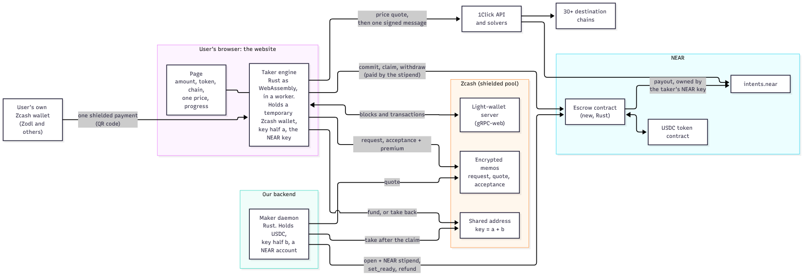
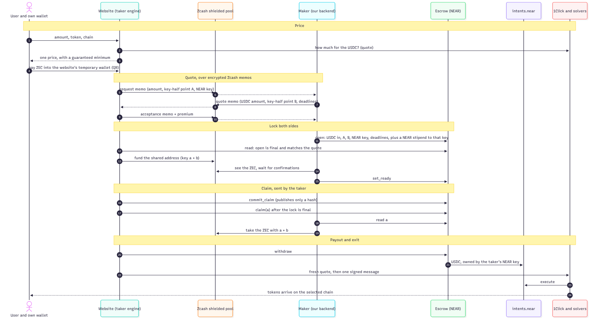

# Zecret

Zecret is a website for swapping shielded ZEC for a token on another chain with no
custodian. A maker locks USDC in an escrow contract on NEAR. The user's ZEC goes to a
shielded Zcash address whose spending key is split in two halves: the user holds one,
the maker holds the other. When the user claims the USDC, the claim publishes the user's
half, and the maker can then take the ZEC. If the maker refunds instead, the refund
publishes the maker's half, and the user takes the ZEC back. The USDC lands inside NEAR
Intents under a key that only the user's browser holds, and one signature sends it on to
a token on another chain.

**The problem.** The Cloakroom paper (October 2026, in this repository as
[`Cloakroom_Yellow_Paper.pdf`](Cloakroom_Yellow_Paper.pdf)) states: "Every route out of
shielded Zcash today passes through a transparent address held by an exchange, a bridge
or an intent network, which publishes amounts and timing and can hold funds." Inside
NEAR Intents, ZEC is the NEP-141 token `nep141:zec.omft.near` (1Click token list, read
on 2026-11-13), not shielded ZEC. Zecret keeps the ZEC in the shielded pool for the whole
swap. The protocol is designed so that neither party can take both sides; the open
issues are listed under [Security](#security).

Zecret builds on Cloakroom, the author's earlier protocol for shielded ZEC and ERC-20
tokens on Base (built for ZECATHON). Cloakroom is the disclosed baseline: commit `2f8e2f7`,
pushed as the branch `pre-hackathon-baseline`. See [Baseline and what is new](#baseline-and-what-is-new).

Built at NEAR HACKATHON (2026-11-01 to 2026-11-14).

## Terms

| Term | Meaning |
|---|---|
| Maker | The other side of the trade. A program that runs in our backend (`zecret maker`). It holds USDC on NEAR and ZEC, quotes prices and opens escrows. |
| Taker | The user. The taker software runs in the user's browser (for tests, also as the native program `zecret taker`). |
| Key half | The shared Zcash address is spent with the key `a + b`. The taker holds `a`, the maker holds `b`. A key half alone cannot spend. |
| Escrow | The NEAR contract in `contracts/near-escrow`. It holds the maker's USDC for one swap and has two exits: `claim(a)` and `refund(b)`. Each exit publishes one key half. |
| Stipend | 0.03 NEAR that the maker sends to the taker's new NEAR key after it opens the escrow. It pays the gas of the taker's own `commit_claim` and `claim`. |
| Verifier | The NEAR Intents contract `intents.near`. It holds token balances per account and executes signed messages (intents). |
| Premium | A small ZEC payment from the taker to the maker, sent with the taker's acceptance of a quote. It pays for the maker's costs. |
| 1Click | The NEAR Intents API (`1click.chaindefuser.com`) that quotes and delivers a swap to another chain. |

## Status

This is the only status table in this file. It states what `STATUS.md` said when it was
read at 2026-11-13 06:52 UTC (its header says "Updated: 2026-11-13 05:56 UTC"), and what
was re-run for this README. It never claims more than `STATUS.md`.

<!-- STATUS TABLE: update this table, and only this table, when STATUS.md changes. -->

| Part | Status | Evidence |
|---|---|---|
| Escrow contract on NEAR (Rust) | **Done.** 57 unit tests, 6 sandbox tests with the live `intents.near` and `wrap.near` code, 8 sandbox tests with the USDC code from mainnet. Deployed on NEAR testnet with no access keys. | [`contracts/near-escrow/README.md`](contracts/near-escrow/README.md), [`docs/DEPLOY.md`](docs/DEPLOY.md) |
| Maker and taker as native programs | **Works locally.** 19 two-party scenarios pass on Zebra regtest and a NEAR sandbox: the happy path, the maker's refund, the punish path, and malicious-maker and malicious-taker cases. | [`harness/RESULTS.md`](harness/RESULTS.md) |
| A swap on public test networks | **Done, once.** The native maker and taker swapped 0.1 testnet ZEC for 3 test USDC on Zcash testnet and NEAR testnet; 222 s to the taker's end. Happy path only. The browser taker was not used. | [`docs/TESTNET.md`](docs/TESTNET.md), [`testnet/EVIDENCE.json`](testnet/EVIDENCE.json) |
| Website | **Works locally against a simulated engine.** Every screen and failure case runs in a browser with no money and no chains. Not hosted. | [`docs/WEB.md`](docs/WEB.md), [`web/README.md`](web/README.md) |
| Taker engine in the browser | **In progress, not verified.** `STATUS.md` lists it under "Running" (package E, started 04:44 UTC): the Rust taker compiled to WebAssembly, in a Web Worker, wired into the website. Not yet checked by the main build session. The latest browser scenario report (06:47 UTC), written while the work runs, shows 4 of 5 scenarios passing. | [`STATUS.md`](STATUS.md), [`harness/BROWSER_RESULTS.md`](harness/BROWSER_RESULTS.md) |
| Exit through NEAR Intents on mainnet | **Not verified.** The library is built and tested: against the live `intents.near` code in a sandbox, and against recorded answers of the live 1Click API. Quote, generate and submit answered without an API key. No exit with real funds was run. On testnet the exit is a direct withdrawal from a stand-in Verifier, because NEAR Intents has no testnet. | [`docs/INTENTS.md`](docs/INTENTS.md) |
| Mainnet deployment | **Not done.** It needs the owner's funds and approval (about 6.6 NEAR). | [`docs/DEPLOY.md`](docs/DEPLOY.md) |
| Security reviews | **Two reviews done.** Review 1 (escrow, Intents library): fixed. Review 2 (swap engines): maker side fixed; taker side open (F2-01 and F2-02 medium, F2-03 low). | [`docs/security/`](docs/security/) |

## How one swap runs

1. The user enters an amount of ZEC, a token, a chain and an address. The page shows one
   price: the USDC that the maker pays for the ZEC, and the destination tokens that NEAR
   Intents pays for that USDC.
2. The browser makes a temporary Zcash wallet, key half `a` and a new ed25519 NEAR key.
   It offers a recovery file. The user pays the ZEC into the temporary wallet once, by
   QR code, from any shielded wallet.
3. The taker sends a request to the maker. The maker answers with a quote. The taker
   accepts and pays the premium. All three messages are encrypted memos in shielded
   Zcash transactions.
4. The maker locks the USDC in the escrow and sends the stipend to the taker's NEAR key.
5. The taker checks the escrow on NEAR and sends the ZEC to the shared address.
6. The maker sees the ZEC and sets the escrow to Ready.
7. The taker sends `commit_claim` and `claim(a)` from its own NEAR key. The claim
   publishes `a`. The maker takes the ZEC with `a + b`.
8. The USDC goes into NEAR Intents, owned by the taker's key. The browser signs one
   message, and NEAR Intents delivers the destination token.

If the maker stops, the taker gets its ZEC back after the maker's refund publishes `b`,
or claims the USDC after a deadline (the punish path). Full rules:
[`docs/DESIGN.md`](docs/DESIGN.md), "The design in plain words".

## How NEAR is used

### 1. The escrow contract

`contracts/near-escrow` is a Rust port of Cloakroom's Solidity escrow (near-sdk 5.30).

- The maker opens a swap with `ft_transfer_call` on the USDC contract. The escrow
  records exactly the amount that arrived.
- `claim(a)` checks `a·G = A` on the Pallas curve (16.8 Tgas) and stores `a` in contract
  state. `refund(b)` does the same for `b`. Neither makes a cross-contract call, so a
  token problem can never stop a key half from being published.
- `commit_claim` checks an ed25519 signature by the taker's key with NEAR's native
  `ed25519_verify` (2.6 Tgas for the call).
- The escrow has no owner and no upgrade method. It is deployed in one transaction that
  deploys the code, calls `new` and deletes the account's only key. The testnet escrow
  `escrow2.zecret-3f109eea1e.testnet` has no access keys; this was checked again for this
  README (step 4 below).

### 2. A new key per swap, paid by a stipend

- The taker's NEAR key is a fresh ed25519 key. Its NEAR account id is the hex of the
  public key (an implicit account). The account does not exist until NEAR arrives.
- After `open`, the maker sends 0.03 NEAR to that account id. The transfer creates the
  account. The taker then sends `commit_claim` and `claim` itself. There is no relayer.
- The maker already knows that the swap exists, so the stipend links nothing new. The
  user's own money never pays NEAR gas, so there is no gas trail to the user.
- Why 0.03 NEAR: NEAR accepts a transaction only if the sender holds the attached gas at
  a pessimistic price. With 0.01 NEAR, `commit_claim` is refused (`NotEnoughBalance`,
  cost 0.0109 NEAR). Commit and claim really cost about 0.002 NEAR. On testnet the taker
  key held 0.02805 NEAR after both.
- On Base, Cloakroom needed a relayer or a funded payout address for this step. The
  paper lists the relayer as an open item.

### 3. Fast finality shortens the safety windows

The protocol's windows are built from a reorganization budget `B_R = (R+1)·D + R·F`,
where `D` is the time to inclusion, `F` the time to finality and `R` the number of
reorganizations survived.

| | Base (paper, Table 3) | NEAR (this repository) |
|---|---|---|
| `D`, `F`, `R` | 10 min, 20 min, 2 | 30 s, 10 s, 2 (configured with margin) |
| `B_R` | 70 min | 110 s |
| Reveal window `W` | 1.75 h | 600 s in the testnet configs |
| Taker must stay online from commit to final claim | hours | about a minute; 10.6 s on the testnet swap (`commit_claim` in a block at 05:42:07.5, claim final at 05:42:18.1) |

Measured on NEAR testnet (`docs/DESIGN.md` §7, `docs/DEPLOY.md`), 14 transactions,
status polled every 0.2 s: submit to inclusion median 1.6 s (max 2.0 s); submit to a
final block median 2.9 s (max 3.3 s); submit to all receipts final median 4.5 s
(max 6.9 s). An earlier measurement with another method gave 7.6 s to inclusion and
10.0 s to full finality. Both are small samples from one machine and one RPC provider.
Mainnet was not measured.

### 4. NEAR Intents as the payout and the exit

- The escrow pays the taker in two steps: it deposits the USDC into its own account
  inside the Verifier, then moves it to the taker's account there with `mt_transfer`. A
  payout happens at most once, also when USDC is paused or an account is blocklisted at
  the wrong moment (tested with the USDC code from mainnet; `docs/security/fixes-2.md`).
- Inside the Verifier, the taker's account is the same hex key as its NEAR account. It
  needs no NEAR to move the tokens: it signs one intent (`raw_ed25519` or `nep413`), and
  another party submits it and pays the gas (1Click on mainnet; on testnet the maker's
  account did it in the recorded swap).
- On mainnet the exit is one `transfer` intent to a 1Click deposit address; 1Click
  delivers the destination token. The 1Click token list had 230 tokens on 39 chains when
  read on 2026-11-13. No API key was needed for quote, generate-intent and submit-intent.
- The website offers the tokens on the 35 chains whose addresses it can check.

### 5. The check before signing

The payload to sign comes from 1Click over the network. `crates/zecret-intents` signs
nothing until `check_generated_intent` passes:

- 1Click's ed25519 signature over the quote is valid, and its signed timestamp is at
  most 5 minutes old;
- the quote matches what the user approved: origin token, amount, destination token,
  recipient, and a minimum output not below the approved minimum;
- the payload is exactly one `transfer`, from the taker's account, on `intents.near`, of
  the approved amount of the approved token, to the quote's deposit address, with no memo
  and no contract call, a deadline in range and a versioned nonce.

The engine runs this check, not the page, so the page cannot be made to sign another
transfer. Details: [`docs/INTENTS.md`](docs/INTENTS.md) §3.

## Try it

All steps start from a clean clone of this repository. They need Linux x86-64, Rust
(1.97.0 was used), Docker, Python 3, Node 22, `gcc` and `curl`. Run the steps from the
repository root unless a step says otherwise.

Each step says whether it was re-run for this README on 2026-11-13, in the build
environment, and shows the output it printed. Durations are from that machine and
exclude the first compile.

### 1. Set up the environment

```sh
./scripts/setup-env.sh
source .tools/env.sh
```

The script adds the Rust WebAssembly targets, downloads the NEAR sandbox 2.14.1 into
`.tools/`, builds a small open-file shim if the machine needs one, downloads the live
`intents.near` and `wrap.near` code from mainnet into `.tools/wasm/`, and pulls the
Zebra 7.0.0-rc.0 image. Safe to run again.

You see:

```text
ready. Run: source .tools/env.sh
sandbox tests: LD_PRELOAD=$ZECRET_SANDBOX_PRELOAD cargo test ...
```

Re-run for this README: yes (tools were already present, so it took 1 s).

`ZECRET_SANDBOX_PRELOAD` is set only on machines that cap open files below 65,535. On
other machines it is empty, and `LD_PRELOAD=` below does nothing.

### 2. Run the escrow tests, including the tests with the real USDC code

```sh
cd contracts/near-escrow
cargo test --lib
LD_PRELOAD=$ZECRET_SANDBOX_PRELOAD cargo test --test sandbox -- --test-threads 1
./fetch-usdc-wasm.sh
LD_PRELOAD=$ZECRET_SANDBOX_PRELOAD cargo test --test usdc -- --test-threads 1
cd ../..
```

You see:

```text
test result: ok. 57 passed; 0 failed; 0 ignored; 0 measured; 0 filtered out; finished in 24.15s
...
test happy_path_claim_into_intents_then_signed_exit ... ok
test new_is_private_and_deployment_leaves_no_keys ... ok
test refund_paths_and_maker_withdraw ... ok
test stipend_needed_for_taker_commit_and_claim ... ok
test result: ok. 6 passed; 0 failed; 0 ignored; 0 measured; 0 filtered out; finished in 70.27s
...
wrote .../.tools/wasm/usdc.near.wasm
test race_with_live_intents_at_each_delay ... ok
test restriction_between_deposit_and_resolve_pays_once ... ok
test verifier_refuses_mt_transfer_then_sweep ... ok
test withdraw_gas_needed ... ok
test result: ok. 8 passed; 0 failed; 0 ignored; 0 measured; 0 filtered out; finished in 373.65s
```

`fetch-usdc-wasm.sh` reads Circle's USDC code from mainnet and keeps it only if its
code hash is `DVJx7F3dHEHJYwpYPwXHu8K9Uo7h4kXFcALucY5oNX8q`. Without that file, each USDC
test prints `SKIPPED` and returns.

Re-run for this README: yes, all three. Durations: about 25 s, 70 s and 6 min.

### 3. Run a swap between two programs on local chains

The scenario runner starts Zebra regtest in Docker and a NEAR sandbox with the escrow,
the live `wrap.near` code (as the token) and the live `intents.near` code. The maker and
the taker are separate processes. They talk only through encrypted memos and the escrow.

One scenario, the happy path:

```sh
python3 -I harness/run.py s1
```

You see, at the end (amounts are in the stand-in token's base units):

```text
[harness 06:27:43]   PASS  taker's balance inside intents.near equals the price 30000000000000000000000000
[harness 06:27:43]   PASS  escrow credit of the taker is zero after withdraw
[harness 06:27:43]   PASS  maker paid exactly the price 30000000000000000000000000
[harness 06:27:43]   PASS  maker ZEC: +lot + premium - quote fee (exact) 100040000
[harness 06:27:43]   PASS  taker ZEC: -(lot + sweep fee) - premium - 3 tx fees (exact) 100090000
[harness 06:27:43]   PASS  privacy audit: all 5 Zcash txs by maker/taker are fully shielded Ironwood v6 (no transparent in/out) []
[harness 06:27:43]   PASS  R4: per-swap secrets erased by every party in a terminal stage (b, s_M, e_M / a, s_T, e_T; joint FVK) checked=['maker:Swept', 'taker:Completed'] not_terminal=[] bad=[]
[harness 06:27:45] SUMMARY: s1 PASS (79s)
```

Above these lines the runner prints the earlier checks of the same scenario: the taker
reached `Completed`, the maker reached `Swept`, the escrow is `Claimed` at a final block,
the taker's NEAR account is the hex of its key and was created by the stipend, and the
taker sent `commit_claim` and `claim` itself. The step-by-step logs of both programs
(encrypted request, quote, acceptance, `open`, stipend, funding, `set_ready`, claim,
sweep, payout) are written to `harness/RESULTS.md` under `s1_happy`.

Re-run for this README: yes; 1 min 48 s in total, of which the scenario took 79 s.

The full set of 19 scenarios:

```sh
python3 -I harness/run.py
```

You see, at the end:

```text
[harness 06:51:28] SUMMARY: s1 PASS (75s), s2 PASS (46s), s3 PASS (70s), s4 PASS (79s), s5 PASS (28s), s6 PASS (67s), s8 PASS (67s), s9 PASS (70s), s10 PASS (78s), s11 PASS (66s), s12 PASS (328s), s15 PASS (16s), s16 PASS (32s), s17 PASS (31s), s18 PASS (68s), s19 PASS (53s), s20 PASS (53s), s21 PASS (65s), s7 PASS (75s)
```

The runner writes the report again to `harness/RESULTS.md`; the table at its top says
what each scenario tests. `s12` is slow because it waits for cover traffic.

Re-run for this README: yes, all 19 PASS, 23 min in total. One difference: another
process was using the runner's NEAR sandbox network port (24667) at that time, so the
full set ran from a copy of `harness/run.py` that differs only in that port (24767). The
single-scenario command above ran from the file as it is.

Notes:

- The runner builds the escrow and the `zecret` binary first (with the test-only
  `misbehave` feature, which the scenarios use to play dishonest parties).
- It uses ports 18232 (Zebra), 3030 and 24667 (NEAR sandbox). The browser runner in
  `harness/browser/` uses 24667 too, so do not run both at once.
- It overwrites `harness/RESULTS.md` and `harness/evidence/`.

### 4. Check the live testnet deployment (read-only)

With the deployment tool. It reads at a final block and spends nothing:

```sh
(cd contracts/near-escrow && cargo build --target wasm32-unknown-unknown --release)
cd deploy
cargo build -p test-usdc --target wasm32-unknown-unknown --release
cargo build -p zecret-deploy
./target/debug/zecret-deploy verify --config configs/testnet.toml
cd ..
```

You see (the block and the balances change over time):

```text
verify testnet at final block 277471610 (4Fyruberb4M6eSxGe3RgWD2DJ9LKbzwucEqgXyPykDDq)
escrow escrow2.zecret-3f109eea1e.testnet (local wasm 525881 bytes, code hash DuBGKiy8dYPFkVHXLj4VFHLZiZ4ngQzssRUbXTCuPKq1)
  [PASS] escrow code hash DuBGKiy8dYPFkVHXLj4VFHLZiZ4ngQzssRUbXTCuPKq1 equals the local wasm
  [PASS] escrow code hash equals the recorded DuBGKiy8dYPFkVHXLj4VFHLZiZ4ngQzssRUbXTCuPKq1
  [PASS] escrow has no access keys (found 0)
  [PASS] escrow get_intents_account = "intents.zecret-3f109eea1e.testnet" (expected intents.zecret-3f109eea1e.testnet)
  [PASS] token usdc.zecret-3f109eea1e.testnet has 6 decimals (symbol "tUSDC")
  [PASS] token code hash 5znPiqS6ocnsGYgeByDsED99dmFS9kv2b7S8dEaL7bRE equals local test-usdc wasm
  [PASS] escrow2.zecret-3f109eea1e.testnet is registered on the token
  [PASS] intents.zecret-3f109eea1e.testnet is registered on the token
  [PASS] maker.zecret-3f109eea1e.testnet is registered on the token
  [PASS] Verifier intents.zecret-3f109eea1e.testnet code hash BtA1BEFNS619KkvXFsgcpQ21Tb5yMm32aaUkn7xNothk equals local intents.near wasm
  [PASS] Verifier current_salt = "1aa14f40"
  [info] maker maker.zecret-3f109eea1e.testnet holds 0.83401 NEAR
  [PASS] maker token balance 19996000000 (target 20000000000)
  [PASS] maker escrow storage funds 0.48552 NEAR
ALL CHECKS PASSED
```

The first line shows that a fresh build of the escrow gives the same code hash as the
deployed escrow. Re-run for this README: yes (build about 2.5 min, `verify` 3 s).

Without building anything, the same escrow facts and the recorded swap, with `curl`:

```sh
RPC=https://rpc.testnet.fastnear.com
ESCROW=escrow2.zecret-3f109eea1e.testnet
q() { curl -s $RPC -H 'content-type: application/json' -d "{\"jsonrpc\":\"2.0\",\"id\":1,\"method\":\"query\",\"params\":$1}"; }
q '{"request_type":"view_account","finality":"final","account_id":"'$ESCROW'"}' | python3 -c 'import json,sys; print(json.load(sys.stdin)["result"]["code_hash"])'
q '{"request_type":"view_access_key_list","finality":"final","account_id":"'$ESCROW'"}' | python3 -c 'import json,sys; print(json.load(sys.stdin)["result"]["keys"])'
ARGS=$(printf '{"id":"%s"}' 04a469d68c2d16588a3face45cd57309198270cb1ed95fdd716159b48e84ace4 | base64 -w0)
q '{"request_type":"call_function","finality":"final","account_id":"'$ESCROW'","method_name":"get_swap","args_base64":"'$ARGS'"}' \
  | python3 -c 'import json,sys; s=json.loads(bytes(json.load(sys.stdin)["result"]["result"])); print(s["state"], s["amount"], s["token"], "a published:", bool(s["a"]), "b:", s["b"])'
```

You see:

```text
DuBGKiy8dYPFkVHXLj4VFHLZiZ4ngQzssRUbXTCuPKq1
[]
Claimed 3000000 usdc.zecret-3f109eea1e.testnet a published: True b: None
```

Re-run for this README: yes.

**The recorded testnet swap** (2026-11-13; full record in
[`docs/TESTNET.md`](docs/TESTNET.md) and [`testnet/EVIDENCE.json`](testnet/EVIDENCE.json)):

| Step | Signer | NEAR testnet transaction |
|---|---|---|
| `open` (3 tUSDC into the escrow) | maker | [`DnGg8B2p…`](https://testnet.nearblocks.io/txns/DnGg8B2paHKMUcXAhzC2hfYQkTitqv3qVzKT5euZVe8x) |
| Stipend 0.03 NEAR to the taker key | maker | [`CTza5f9X…`](https://testnet.nearblocks.io/txns/CTza5f9XvaCXYuXSoGsjSgiA3k3RGRxjNehfp76TXHbf) |
| `set_ready` | maker | [`9kn4hxVU…`](https://testnet.nearblocks.io/txns/9kn4hxVUxMqd16AzvkwaWQUouYhDrVeoJdyPp4cUXqix) |
| `commit_claim` | taker key | [`8fdBEHbF…`](https://testnet.nearblocks.io/txns/8fdBEHbFBN4p64YFuNyHCX8v2TApKSyQaZjiAxaUVrds) |
| `claim` (publishes `a`) | taker key | [`DGShdiHZ…`](https://testnet.nearblocks.io/txns/DGShdiHZfLWRyUyWX69dDCt14JV86FFHJq1Twowmk3Dz) |
| `withdraw` (two-step payout into the Verifier) | maker | [`DodbZPET…`](https://testnet.nearblocks.io/txns/DodbZPEToNesVSF5G9yQUogm1zN9FqF3hdTdwEGPepL6) |
| Exit: `execute_intents` with one `ft_withdraw` signed by the taker key | maker (relay) | [`D2eRTKBN…`](https://testnet.nearblocks.io/txns/D2eRTKBNsJtbasRARwyjGPfjqQ9zYAQQG9LKCiJFic3z) |

Accounts: escrow
[`escrow2.zecret-3f109eea1e.testnet`](https://testnet.nearblocks.io/address/escrow2.zecret-3f109eea1e.testnet),
taker key
[`15968c4a…a9067`](https://testnet.nearblocks.io/address/15968c4ae680388e6c4b4511de8cfaab2a71a8eb0023f2f787ccdc085a2a9067),
maker
[`maker.zecret-3f109eea1e.testnet`](https://testnet.nearblocks.io/address/maker.zecret-3f109eea1e.testnet).
For this README each of the seven hashes was read again through the NEAR testnet
archival RPC: all are final and succeeded. The explorer pages were not opened from the
build machine. The six Zcash testnet transactions of the swap are listed in
`docs/TESTNET.md`; they were read through the light-wallet server only.

### 5. Use the website

Against the simulated engine (no money, no chains; prices are live from 1Click):

```sh
cd web
npm install
npm run dev
```

Open `http://localhost:5173/?speed=20` and do this:

| Do | See |
|---|---|
| Open the page. | A banner: "Demo with a simulated engine: no real funds move. Running 20× faster than real time." |
| Enter `1` in "You pay". Keep USDC on Base. Paste `0x5aAeb6053F3E94C9b9A09f33669435E7Ef1BeAed` as the address. | One price line, for example "You pay 1.00 ZEC. You receive at least 918.9879 USDC on Base." (the amount follows the live price). |
| Press "Continue". | "Save your recovery file". |
| Press "Save recovery file", then "Continue to payment". | A file `zecret-recovery-<id>.json` downloads. "Send exactly 1.00 ZEC", a QR code and a `utest1…` address. |
| Press "Simulate the payment". | The progress screen with six step groups. After about 30 s: "You received 937.6471 USDC on Base" (the amount varies), and "What this swap revealed". |

"Demo controls" in the banner run each failure case (maker does not answer, maker
refunds, delivery below the minimum, cleared browser and restore, and more).

Re-run for this README: yes, through headless Chromium against `npm run dev`; the lines
above are what it printed. `npm install` was not re-run (the dependencies were already
installed).

The website's own tests:

```sh
npm test          # unit tests (vitest)
npm run e2e       # browser tests, desktop and phone (Playwright; builds the site first)
cd ..
```

`npm test` printed `Tests  61 passed (61)` for this README. `npm run e2e` was not re-run
for this README, because it rebuilds `web/dist`, which another process was using at that
time; `STATUS.md` records 34 browser tests passing.

Against local chains, with the real engine in the browser: see
[`web/README.md`](web/README.md), "Against the local network". It builds the WebAssembly
engine and runs Zebra regtest, a NEAR sandbox and a maker on the build machine.

Not re-run for this README: the engine was still being built, and its builder was using
the ports and the build output (`web/dist`) of that setup.

### 6. Run the Intents library tests

```sh
cd crates/zecret-intents
LD_PRELOAD=$ZECRET_SANDBOX_PRELOAD cargo test
cd ../..
```

You see:

```text
test result: ok. 24 passed; 0 failed; ...      (unit)
test result: ok. 21 passed; 0 failed; ...      (recorded 1Click answers)
test result: ok. 2 passed; 0 failed; ...       (sandbox, live intents.near code)
```

The recorded tests replay the whole exit against answers recorded from the live 1Click
API and run every refusal of the check before signing on real payloads. The sandbox
tests deposit a token for a key with no NEAR account and move it with a signed intent.
Re-run for this README: yes, about 2 min including the build.

## Architecture






The sources of the diagrams are the `.mmd` files in [`docs/diagrams/`](docs/diagrams/).

| Component | Runs where | Job |
|---|---|---|
| Page (`web/`) | User's browser | Amount, token and chain; one price; progress; recovery file. Holds no keys. |
| Taker engine (`crates/zecret-wasm`, `crates/zecret-core`) | User's browser, in a Web Worker | The taker's state machine and a temporary Zcash wallet, compiled to WebAssembly. Holds `a` and the NEAR key. |
| Maker (`crates/zecret-node`, binary `zecret`) | Our backend | Holds USDC, ZEC, `b` and a NEAR account. Quotes, opens escrows, sends stipends, takes the ZEC, refunds. |
| Escrow (`contracts/near-escrow`) | NEAR | Holds the maker's USDC. Two exits, each publishing one key half. |
| `intents.near` | NEAR | Receives the payout for the taker's key. |
| Light-wallet server | Zcash | Gives the browser blocks and takes its transactions over gRPC-web. |
| 1Click API and solvers | Off-chain | Quote the exit and deliver on the destination chain. |

The maker and the taker engine use the same Rust code (`zecret-core`), which has no I/O
of its own. The native programs and the browser give it a network function, a store and
the time.

### Repository map

| Path | What it is | Baseline or new |
|---|---|---|
| `contracts/near-escrow/` | The NEAR escrow contract and its tests | New |
| `crates/zecret-core/` | Shared swap code: keys, memos, light wallet, NEAR client, taker and maker state machines | New, derived from Cloakroom's `node/` |
| `crates/zecret-node/` | The native `zecret` binary: maker daemon, reference taker, local devnet tool | New |
| `crates/zecret-wasm/` | The taker engine for the browser (wasm-bindgen) | New |
| `crates/zecret-intents/` | The exit through NEAR Intents and the check before signing | New |
| `deploy/` | Deployment and check tool, test USDC token, testnet deployment record, maker service notes | New |
| `web/` | The website | New |
| `harness/run.py` | Two-party scenario runner on Zebra regtest and a NEAR sandbox | Rewritten from the baseline runner |
| `harness/browser/` | Scenarios with the taker in headless Chromium | New |
| `testnet/` | Evidence of the swap on public test networks | New |
| `spike/browser-wallet/` | The first test of the Zcash wallet in a browser worker | New |
| `docs/` | Design, build plan, engine, website, Intents, deployment, testnet, security reviews, measurements | New, except `swap-sequence.*` |
| `scripts/setup-env.sh` | Environment setup | New |
| `node/` | Cloakroom's Rust client for Base | Baseline, unchanged |
| `contracts/src/`, `contracts/test/`, `contracts/audit/` | Cloakroom's Solidity escrow, tests and audit notes | Baseline, unchanged |
| `formal/` | TLA+ model of the protocol and TLC logs | Baseline, unchanged |
| `app/`, `design-system/` | Cloakroom's local web UI and design tokens | Baseline, unchanged (the new website uses two of its fonts) |
| `Cloakroom_Yellow_Paper.pdf` | The protocol paper | Baseline |

The documents are indexed in [`docs/README.md`](docs/README.md).

## Security

### What was reviewed and fixed

| Review | Scope | Found | State |
|---|---|---|---|
| [Review 1](docs/security/review-1.md) | Escrow contract, Intents library | F-01 medium: a third party could take a maker's swap id with a fake token. F-02 low: quote freshness was read from an unsigned field. | Both fixed with regression tests ([fixes-1](docs/security/fixes-1.md)). |
| [NV-02](docs/security/nv02-usdc.md) | The escrow's payout with Circle's USDC code | A USDC pause or blocklist between delivery and USDC's resolve step made the old payout restore a credit that was already paid, so a second `withdraw` paid twice. Reproduced in a sandbox. | Fixed with a two-step payout ([fixes-2](docs/security/fixes-2.md)); new testnet escrow `escrow2`. |
| [Review 2](docs/security/review-2.md) | Swap engines (`zecret-core`, `zecret-node`) | F2-04 medium: unpaid requests slowed the maker without limit. F2-01 medium, F2-02 medium, F2-03 low: taker-side bugs. | F2-04 and maker-side hardening fixed ([fixes-2-core](docs/security/fixes-2-core.md)). F2-01, F2-02, F2-03 are open. |

No review found a way for a third party to take funds. Not reviewed: the browser engine
(`crates/zecret-wasm`), the website, the Zcash proving and signing internals, and the
TLA+ model against the code.

### What remains open

- **Taker-side bugs of review 2.** F2-01: after a maker's refund, the taker can erase
  `a` while its funding note is still unspent. F2-02: the first `claim(a)` is sent
  without checking the reveal deadline again. F2-03: an oversized reveal window can
  freeze both sides. A malicious maker could use F2-01 or F2-02 against an honest taker
  under the conditions in the review.
- **One trusted NEAR RPC endpoint.** The taker reads every NEAR fact it acts on from one
  RPC endpoint, without proofs. An endpoint that colludes with the maker can show an
  escrow that does not exist and take the taker's ZEC. Options (several endpoints, light
  client proofs) are in `docs/security/fixes-2-core.md` §4. Not built.
- **A residual USDC case.** If the Intents deposit fails and USDC's resolve step panics
  in the same window, the tokens stay in the Intents contract credited to nobody, and
  the last USDC withdraw from the escrow fails until the Intents operators return them.
  Nobody is paid twice. Not tested (`docs/security/fixes-2.md` §5).
- **The taker cannot pay for `withdraw`.** `withdraw` needs 200 Tgas, so the sender must
  hold about 0.2 NEAR; the stipend leaves about 0.028 NEAR. The maker sends `withdraw`
  after the claim. If the maker stops after the claim, the USDC stays in the escrow,
  credited to the taker, until some account sends `withdraw`. Any account can send it,
  and the tokens can only go to the taker.
- **Keys in browser storage.** The temporary wallet key, `a` and the NEAR key are kept in
  the browser's storage and in the recovery file, which is not encrypted. A cleared
  browser without the recovery file loses the swap's keys.
- **Timing privacy.** A swap that is not delayed hides among few others (the paper's
  timing analysis). Cover delays exist in the code and in one scenario (`s12`), but are
  off in the testnet configs and the website.
- **Network observers.** The light-wallet server, the NEAR RPC and 1Click see the user's
  IP address unless the user uses Tor or a VPN.
- **Third parties on the exit.** 1Click and its solvers deliver the destination token.
  The check before signing proves what was signed, not that 1Click delivers.

## Limits and what is not built

- No hosted website and no hosted maker. Both are prepared (`web/vercel.json`,
  `deploy/maker/`) and wait for the owner's approval.
- No mainnet deployment and no exit with real funds through 1Click.
- The swap on public test networks ran once, with the native programs, on the happy path.
  Refund and punish paths ran only on local chains.
- On testnet the token is a stand-in (`tUSDC`, no value) and the Verifier is a stand-in
  that runs the code of mainnet `intents.near`. NEAR Intents has no testnet.
- The maker sends no answer to a request above its limit; the taker then waits for its
  quote timeout. The maker's directory entry does not publish its limits.
- Only Chromium was tested. Firefox and Safari were not.
- One swap per browser at a time.
- The measurement code behind `docs/experiments/` is not in this repository; only the
  write-ups are.

## Baseline and what is new

NEAR HACKATHON allows earlier work if it is disclosed (rules Q-001 to Q-005). This is the
disclosure.

- **Baseline.** Cloakroom, by the same author, built for another hackathon (ZECATHON) and
  another chain (Base). It trades shielded ZEC for ERC-20 tokens with a Solidity escrow.
  The first commit of this repository imports selected folders of
  [`officialcmg/cloakroom`](https://github.com/officialcmg/cloakroom) at commit
  `bad9fa37f6fb82475ed222bd300f1a3ffc7e08a9` (2026-10-28), under the MIT licence. That
  baseline commit is `2f8e2f7`, pushed as the branch **`pre-hackathon-baseline`**. The
  build clone also tags it `pre-hackathon`; the remote has no tags yet, because the git
  proxy of the build environment refuses to push tags, and the owner can push the tag.
  Nothing in the baseline commit was written for NEAR HACKATHON.
  Details: [`BASELINE.md`](BASELINE.md).
- **The diff:**
  [`https://github.com/officialcmg/zecret/compare/pre-hackathon-baseline...main`](https://github.com/officialcmg/zecret/compare/pre-hackathon-baseline...main).

| Part | Baseline (Cloakroom) | Built in the hackathon window |
|---|---|---|
| Protocol | The split-key swap, its wallet rules, proofs and TLA+ model | No change to the rules. The relayer and its fee are removed; the stipend replaces them. |
| Escrow | Solidity on Base | A new Rust contract for NEAR: NEP-141 open, ed25519 commit, key halves stored in state, prepaid storage, two-step payout into NEAR Intents, `sweep` |
| Client | Rust maker and taker for Base, shelling out to `cast`, blocking HTTP | `zecret-core`: no I/O, runs in steps, builds for WebAssembly; a NEAR client (transactions, RPC, escrow calls); the stipend; checks of the escrow's code, keys and Intents account before funding; maker limits on unpaid requests and the premium check |
| Browser | None (Cloakroom's UI drove a local client) | A taker engine in a Web Worker; a new website |
| Exit to other chains | None | `zecret-intents`: 1Click quote, check before signing, signed exit |
| Deployment | Base | `zecret-deploy`; a NEAR testnet deployment |
| Tests | Scenarios on Zebra regtest and anvil | 19 scenarios on Zebra regtest and a NEAR sandbox; sandbox tests with live `intents.near`, `wrap.near` and USDC code; browser tests; one swap on public test networks |
| Security | Cloakroom audit notes for the Solidity escrow | Two reviews of the new code, with fixes |

### Libraries, templates and tools

- **Own earlier work:** Cloakroom (above). `zecret-core` takes its key, memo, wallet and
  state-machine code from Cloakroom's `node/`.
- **NEAR:** `near-sdk` and `near-contract-standards` 5.30 (escrow, test token),
  `near-workspaces` 0.24 (deployment tool and sandbox tests), nearcore sandbox 2.14.1.
  Tests and the testnet stand-in Verifier run the wasm of mainnet `intents.near`
  (source: `github.com/near/intents`, MIT) and `wrap.near`; the USDC tests run the wasm
  of Circle's USDC on NEAR, downloaded at test time and not stored in the repository.
- **Zcash:** `orchard` 0.16, `zcash_primitives` 0.31.0-pre.1, `zcash_address`
  0.14.0-pre.1, `zcash_client_backend` 0.25.0-pre.1, `pczt` 0.10.0-pre.1,
  `zcash_note_encryption`, `halo2_proofs`, `pasta_curves`, `shardtree`,
  `incrementalmerkletree`; Zebra 7.0.0-rc.0 in Docker for local tests.
- **Cryptography and encoding:** `ed25519-dalek`, `chacha20poly1305`, `sha2`,
  `blake2b_simd`, `bs58`, `base64`, `hex`, `serde`, `serde_json`.
- **Native client and tools:** `reqwest` with `rustls`, `tokio`, `toml`, `chrono`,
  `anyhow`; `wasm-bindgen` 0.2.129 for the browser engine.
- **NEAR Intents:** the 1Click API. The quote signature check follows
  `verifyQuoteSignature` in `@defuse-protocol/one-click-sdk-typescript` 0.1.26 (read,
  not used as a dependency).
- **Website:** React 19, Vite, TypeScript, `qrcode`, `@noble/hashes`, Fraunces
  (`@fontsource-variable/fraunces`), Archivo and IBM Plex Mono (from Cloakroom's
  `design-system/`); tests with Vitest, Playwright and ESLint.
- **No project template** was used.
- Parts of the code and documentation were written with AI coding assistance, and were
  reviewed and tested as described in this file and in `docs/`.

Exact versions are in the `Cargo.lock` files and `web/package-lock.json`.

## Tracks

| Track | Why it fits |
|---|---|
| `defi`: Unstoppable DeFi | An exchange with no custodian that settles across chains through NEAR Intents: the escrow holds the maker's USDC, and the user exits to a token on another chain with one signed intent. |
| `privacy`: Privacy & Private AI | Private finance: the user's ZEC stays in Zcash's shielded pool for the whole swap, the messages are encrypted memos, and the user's NEAR key is new for each swap and paid by the maker, so no gas payment links the user to the swap. |

## Licence

MIT. See [`LICENSE`](LICENSE).
