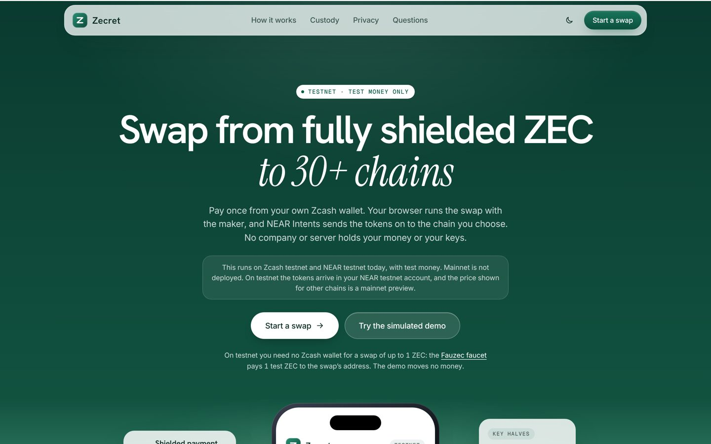
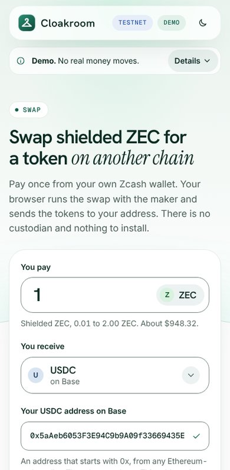
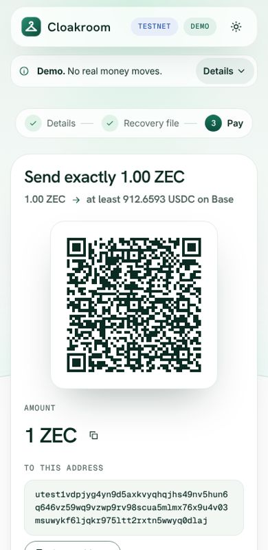
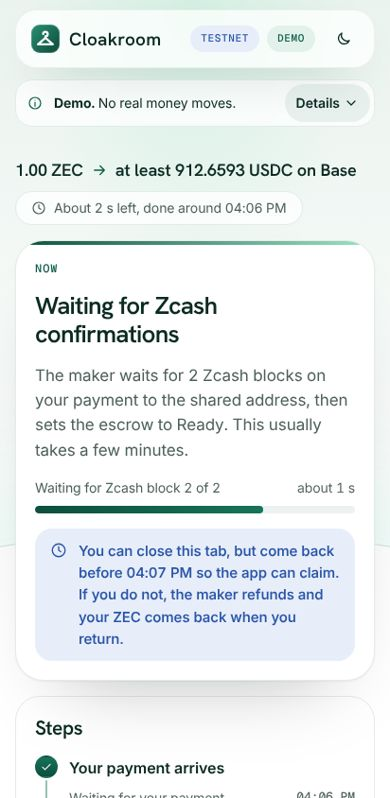
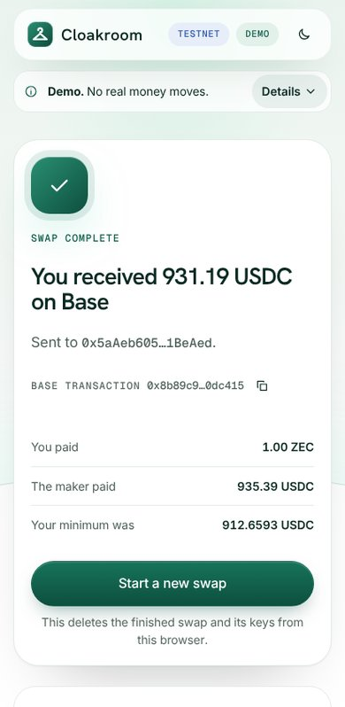
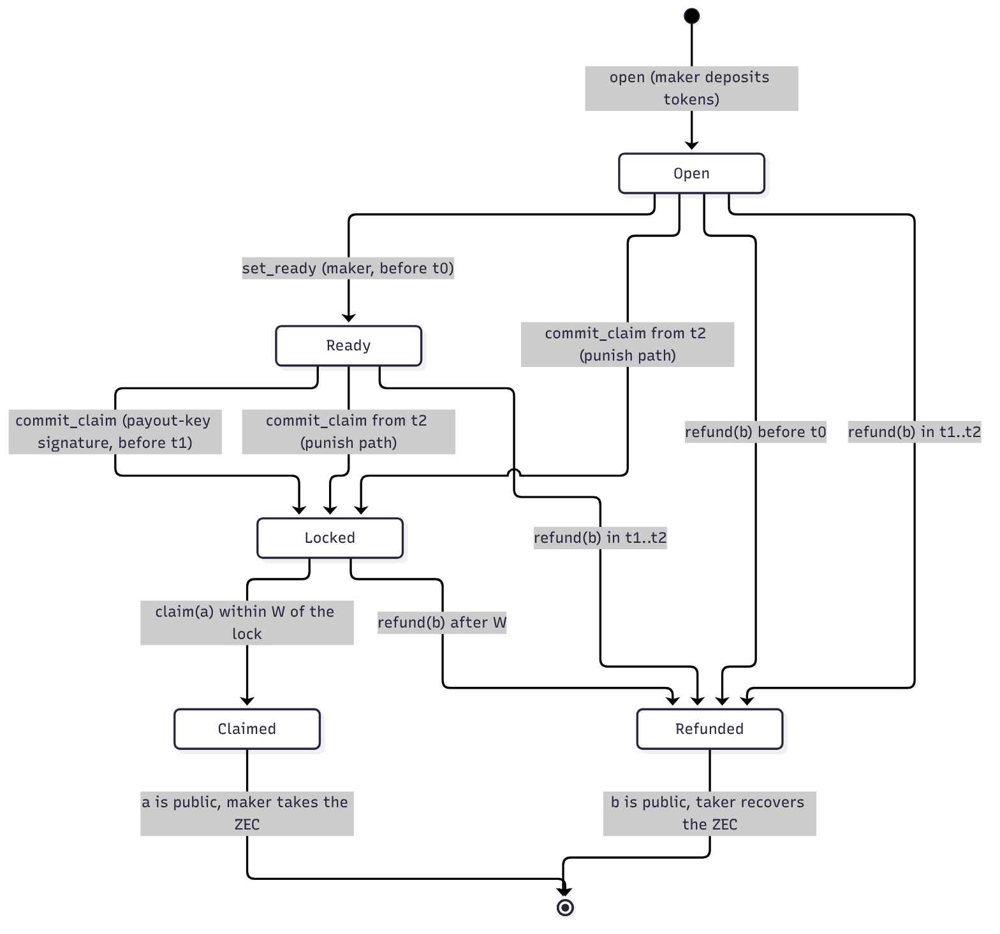

# Cloakroom Intents

Cloakroom Intents is a website for swapping shielded ZEC for tokens on 30+ chains with no
custodian.

**The problem.** NEAR Intents already swaps ZEC, but only from a transparent address, as a
bridged token. Inside NEAR Intents, ZEC is the NEP-141 token `nep141:zec.omft.near` (1Click
token list, read on 2026-11-13), not shielded ZEC. The Cloakroom paper (October 2026, in
this repository as [`Cloakroom_Yellow_Paper.pdf`](Cloakroom_Yellow_Paper.pdf)) states:
"Every route out of shielded Zcash today passes through a transparent address held by an
exchange, a bridge or an intent network, which publishes amounts and timing and can hold
funds."

What is different here:

- The ZEC stays in the shielded pool on its way to the maker, and no bridge or custodian
  holds it. It goes to a shielded Zcash address whose spending key is split in two halves:
  the user holds one, the maker holds the other.
- A maker locks USDC in an escrow contract on NEAR. When the user claims the USDC, the
  claim publishes the user's half, and the maker can then take the ZEC. If the maker
  refunds instead, the refund publishes the maker's half, and the user takes the ZEC back.
- The USDC lands in NEAR Intents under a key made in the user's browser, new for each
  swap. The maker pays that key's gas, so no gas payment links the swap to the user's own
  NEAR accounts ([details](#2-a-new-key-per-swap-paid-by-a-stipend)).
- One signature from the browser sends the USDC on to a token on another chain, through
  NEAR Intents.
- Everything on the user's side runs in the browser. The user pays once, by QR code, from
  a shielded wallet.

The protocol is designed so that neither party can take both sides, provided the user's
browser acts before the deadlines and its NEAR RPC endpoint answers honestly. The open
issues are listed under [Security](#security).

**What runs today:** the website and one maker on Zcash testnet and NEAR testnet, at
<https://cloakroom.chrismg.dev>. There a swap pays shielded testnet ZEC for test USDC,
delivered to a NEAR testnet account. 38 swaps completed on these networks, 37 of them
through the website. To run one, see [Try it](#try-it).

**Built, not run with funds:** the delivery to other chains through NEAR Intents' 1Click
API. It is tested against the live `intents.near` code in a sandbox and against recorded
1Click answers. Mainnet is planned and not deployed.



| Price | Payment | Progress | Done |
|---|---|---|---|
|  |  |  |  |

The first picture is the hosted site. The four phone pictures are from the simulated demo
(`/?demo=1`), which moves no money.

Cloakroom Intents is Cloakroom, my earlier protocol for shielded ZEC and ERC-20 tokens on
Base (built for ZECATHON), rebuilt on NEAR with NEAR Intents as the exit. The disclosed
baseline is commit `2f8e2f7` on the branch `pre-hackathon-baseline`; what came from it and
what is new is under [Baseline and what is new](#baseline-and-what-is-new).

Built at NEAR HACKATHON (2026-11-01 to 2026-11-14). The project was named Zecret until
2026-11-14 ([the old name Zecret](#the-old-name-zecret)).

## What NEAR does here

All four parts were built in the hackathon window ([details](#how-near-is-used)).

- The escrow contract, with no owner and no access keys
  ([escrow](#1-the-escrow-contract), [`contracts/near-escrow`](contracts/near-escrow/README.md)).
- The payout inside NEAR Intents: one `mt_transfer` from the escrow to the taker's key
  ([payout](#4-near-intents-as-the-payout-and-the-exit)).
- A new implicit NEAR account for each swap. The maker's 0.06 NEAR stipend creates it and
  pays its gas ([stipend](#2-a-new-key-per-swap-paid-by-a-stipend)).
- The exit: the taker's key signs one intent, and 1Click (mainnet) or the maker's relay
  (testnet) submits it and pays the gas. On mainnet the engine checks 1Click's payload first
  ([check](#5-the-check-before-signing), [`crates/zecret-intents`](crates/zecret-intents/)).

Contents: [Terms](#terms) · [Status](#status) · [Try it](#try-it) · [One swap](#how-one-swap-runs) ·
[NEAR](#how-near-is-used) · [Architecture](#architecture) · [Security](#security) ·
[Limits](#limits-and-what-is-not-built) · [Baseline](#baseline-and-what-is-new) · [Tracks](#hackathon-tracks) · [Names](#the-old-name-zecret)

## Terms

| Term | Meaning |
|---|---|
| Maker | The other side of the trade. A program that runs in my backend (`zecret maker`). It holds USDC on NEAR and ZEC, quotes prices and opens escrows. |
| Taker | The user. The taker software runs in the user's browser (for tests, also as the native program `zecret taker`). |
| Temporary wallet | A Zcash wallet that the browser makes for one swap. The user pays into it once. |
| Shared address | The Zcash address that holds the user's ZEC during the swap. It is spent with the key `a + b`. |
| Key half | The taker holds `a`, the maker holds `b`. A key half alone cannot spend from the shared address. |
| Escrow | The NEAR contract in `contracts/near-escrow`. It holds the maker's USDC for one swap, inside NEAR Intents, and has two exits: `claim(a)` and `refund(b)`. Each exit publishes one key half and makes the payout due: one `mt_transfer` inside NEAR Intents to the taker or to the maker. A light `withdraw(id)` call (19 Tgas) sends a due payout. |
| Stipend | 0.06 NEAR that the maker sends to the taker's new NEAR key after it opens the escrow. It pays the gas of the taker's own `commit_claim`, `claim` and `withdraw(id)`. |
| Premium | A small ZEC payment from the taker to the maker, sent with the taker's acceptance of a quote. It pays for the maker's costs. |
| Verifier | The NEAR Intents contract: `intents.near` on mainnet; on testnet a stand-in, `intents.zecret-3f109eea1e.testnet`, that runs the same code. It holds token balances per account and executes signed messages (intents). |
| 1Click | The NEAR Intents API (`1click.chaindefuser.com`) that quotes and delivers a swap to another chain. |
| Relay | On testnet and local chains only: the maker's HTTPS endpoint that sends the taker's signed exit to the Verifier and pays its gas. |
| Recovery file | A file with the swap's keys. With it, another browser can continue the swap: finish it, or take the ZEC back. Only Chromium was tested. |
| TAZ, test USDC | Testnet ZEC, and the stand-in USDC token on NEAR testnet (`tUSDC`). Neither has value. |

## Status

This is the only status table in this file. It follows `STATUS.md` as of 2026-11-14
14:30 UTC. Counts are from the linked runs; [Try it](#try-it) says how to rerun them.

<!-- STATUS TABLE: update this table, and only this table, when STATUS.md changes. -->

| Part | Status | Evidence |
|---|---|---|
| Escrow contract on NEAR (Rust) | **Done.** 57 unit tests, 6 sandbox tests with the live `intents.near` and `wrap.near` code, 8 sandbox tests with the USDC code from mainnet. Deployed on NEAR testnet with no access keys. | [`contracts/near-escrow/README.md`](contracts/near-escrow/README.md), [`docs/DEPLOY.md`](docs/DEPLOY.md) |
| Maker and taker as native programs | **Works on local chains.** 25 two-party scenarios pass on Zebra regtest and a NEAR sandbox: the happy path, the maker's refund, the punish path, a Zcash chain reorganisation under a running maker, and malicious-maker and malicious-taker cases. All 25 passed on 2026-11-14. | [`harness/RESULTS.md`](harness/RESULTS.md) |
| Taker engine in the browser | **Works on local chains and on testnet.** The Rust taker runs as WebAssembly in a Web Worker behind the website. Six browser scenarios pass in headless Chromium on Zebra regtest and a NEAR sandbox: a full swap with exit, a refund after the maker goes quiet, two reloads during a swap, a restore from the recovery file in a fresh browser, a quote below the minimum, and the maker stopping right after the claim. | [`harness/BROWSER_RESULTS.md`](harness/BROWSER_RESULTS.md) |
| Swaps on public test networks | **38 completed**, the last 32 on 2026-11-14 ([`docs/TESTNET.md`](docs/TESTNET.md)). One maker fault was found on the way and fixed: it missed a refund when its only NEAR endpoint refused every request; a deliberately abandoned swap was then refunded in 5 minutes ([incident note](docs/incidents/2026-11-14-maker-missed-refund.md)). The first six: (1) The native maker and taker: 0.1 TAZ for 3 test USDC, 222 s to the taker's end. Through the hosted website and the hosted maker: (2) 0.05 TAZ for 1.4877 test USDC, 493 s from the payment to done; (3) 0.01 TAZ for 0.2877 test USDC, 392 s; (4) 0.05 TAZ for 1.4877 test USDC, 314 s, paid by the Fauzec faucet with no wallet. (5) 0.01 TAZ for 0.2877 test USDC, 453 s, the swap recorded for the demo video; (6) the same amount, about 6 minutes, 8.5 hours after the wallet fix below. A restore of (4) in a fresh browser sent the 0.9499 TAZ surplus back to the return address. One more hosted run stopped before funding (quote below the minimum) and returned the deposit. On 2026-11-13 from 14:30 to 16:35 UTC the hosted maker did not answer: its wallet no longer matched the chain. Two swaps in that time refunded after the 10-minute wait, with no loss. The fix and the cause are in [`docs/incidents/2026-11-13-maker-unknown-anchor.md`](docs/incidents/2026-11-13-maker-unknown-anchor.md). Escrow refund and punish paths ran only on local chains. | [`docs/TESTNET.md`](docs/TESTNET.md), [`testnet/EVIDENCE.json`](testnet/EVIDENCE.json), [`testnet/hosted/`](testnet/hosted/) |
| Website | **Hosted on testnet.** Landing page, the swap app with the real engine, and a simulated demo. 110 unit tests and 92 Playwright tests (desktop and phone). Chromium only; Firefox and WebKit projects exist but were not run. | [`docs/WEB.md`](docs/WEB.md), [`docs/HOSTING.md`](docs/HOSTING.md) |
| Maker with its relay | **Hosted on testnet** (Railway), with its own wallet and NEAR key made on its volume. | [`docs/HOSTING.md`](docs/HOSTING.md) |
| Exit through NEAR Intents on mainnet | **Not verified.** The library is tested against the live `intents.near` code in a sandbox, and against recorded answers of the live 1Click API. Quote, generate and submit answered without an API key. No exit with real funds was run. On testnet the exit is a direct withdrawal from a stand-in Verifier, because NEAR Intents has no testnet. | [`docs/INTENTS.md`](docs/INTENTS.md) |
| Mainnet deployment | **Not done.** Nothing is deployed on mainnet. It needs real funds (about 6.6 NEAR) and the owner's approval. | [`docs/DEPLOY.md`](docs/DEPLOY.md) |
| Wallet apps as the payer | **Not tested.** Zkool and Zingo (Android) offer testnet wallets and support the Ironwood pool per their release notes. Zodl, Cake and Edge ship no testnet app. | [`docs/WEB.md`](docs/WEB.md) |
| Security reviews | **Five reviews; fix reports cover every confirmed finding.** Review 1 (escrow, Intents library), the follow-up on the real USDC contract (a double payment), review 2 (swap engines, maker and taker side) and review 3 (website, browser engine, relay). A fourth, read-only review found no new finding. Review 5 (the light-payout escrow) found one low finding, handled in the client. The taker-side fixes of review 2 were checked by tests, not by a new review. Open by decision: one trusted NEAR RPC endpoint; the operators of NEAR Intents can move or freeze the escrow's USDC during a swap. | [`docs/security/`](docs/security/), [Security](#security) |

## Try it

### 1. Open the website

No install and no wallet.

| Do | See |
|---|---|
| Open <https://cloakroom.chrismg.dev>. | The landing page: how a swap works, who holds the money, what stays private and what is public, what happens on a failure, status, questions. |
| Press "Try the simulated demo" (or open `/?demo=1`). | The swap form with a one-line banner: "Demo. No real money moves." |
| Enter `1` in "You pay". Keep USDC on Base. Paste `0x5aAeb6053F3E94C9b9A09f33669435E7Ef1BeAed` as the address. | One price line, for example "You pay 1.00 ZEC. You receive at least 918.9879 USDC on Base." Prices are live from 1Click. |
| Press "Continue", then "Save recovery file", then "Continue to payment". | A file `cloakroom-intents-recovery-<id>.json` downloads. "Send exactly 1.00 ZEC", a QR code and a `utest1…` address. |
| Press "Simulate the payment". | The progress screen with six step groups, then "You received … USDC on Base" and "What this swap revealed". |
| Press "Details" in the banner, then "Demo controls". | Each failure case: the maker does not answer, the maker refunds, delivery below the minimum, a cleared browser and restore, and more. |

The simulated demo runs in real time on the hosted site. Locally, `?speed=20` runs it 20
times faster ([`web/README.md`](web/README.md)).

### 2. Swap on testnet through the website

Real Zcash testnet and NEAR testnet transactions, test money only. No wallet is needed:
the Fauzec faucet (<https://fauzec.com>) can pay the swap's deposit address directly.

The test USDC goes to a NEAR testnet account that is registered with the test token
`usdc.zecret-3f109eea1e.testnet`. The project's account `zecret-3f109eea1e.testnet` is
registered; enter it to skip this. For your own account, with
[near-cli-rs](https://github.com/near/near-cli-rs) (syntax from its guide; not run for
this README):

```sh
near account create-account sponsor-by-faucet-service <name>.testnet autogenerate-new-keypair save-to-keychain network-config testnet create
near contract call-function as-transaction usdc.zecret-3f109eea1e.testnet storage_deposit json-args '{"account_id":"<name>.testnet","registration_only":true}' prepaid-gas '30 Tgas' attached-deposit '0.00125 NEAR' sign-as <name>.testnet network-config testnet sign-with-keychain send
```

| Do | See |
|---|---|
| Open <https://cloakroom.chrismg.dev> and press "Start a swap". | The app at `/swap` with the banner "Testnet. Test money only." The engine downloads (9 MB) and prepares its keys (20 s in the recorded runs). |
| Enter an amount between 0.001 and 0.1 TAZ (the hosted maker's limits), a token and chain, and the NEAR testnet account. If you have a Zcash testnet wallet, add its address as the return address. | One price line. The price for the chosen chain is a mainnet preview: on testnet the swap pays test USDC to the NEAR account. |
| Save the recovery file and continue to payment. | "Send exactly …", a QR code and a `utest1…` address. |
| Copy that address into the form on <https://fauzec.com> (it has a human check) and claim. Or pay the exact amount from a wallet. | The progress screen. Keep the tab open while it says so (during the claim). |
| Wait. | "You received … test USDC on NEAR". The faucet-paid run took 314 s from the payment to done. |

The faucet pays 1 TAZ. The site swaps the amount you entered and sends the rest to the
return address; without one, it asks for an address at the end, and "Start a new swap"
stays disabled until the rest is sent or you confirm leaving it behind. The faucet gives
one claim per address per 24 hours and has a cooldown per network.

Wallets: the engine reads only the Ironwood pool. Which wallet apps could pay is in the
[Status](#status) table; none was tested against this site. The command-line payer:
[`docs/TESTNET.md`](docs/TESTNET.md), "A fresh testnet payer". Each recorded run and its
transactions are in the same file.

Most of the time is spent waiting for Zcash blocks (23 s on average on testnet, with long
gaps) and three proofs in the browser (about 30 s each).

### 3. Run the swap on local chains

All steps start from a clean clone. They need Linux x86-64, rustup, Docker, Python 3,
Node 22, `gcc` and `curl`. `rust-toolchain.toml` makes rustup install and use Rust
1.97.0 with the WebAssembly targets. Run the steps from the repository root.

Set up the environment:

```sh
./scripts/setup-env.sh
source .tools/env.sh
```

The script stops on a host that is not Linux x86-64 or lacks rustup, curl or Python 3,
and warns when Docker, Node or gcc is missing. It adds the Rust WebAssembly targets,
downloads the NEAR sandbox 2.14.1 into `.tools/`, builds a small open-file shim if the machine needs one, downloads the live
`intents.near` and `wrap.near` code from mainnet into `.tools/wasm/`, and pulls the
Zebra 7.0.0-rc.0 image. You can run it again. It ends with:

```text
ready. Run: source .tools/env.sh
sandbox tests: LD_PRELOAD=$ZECRET_SANDBOX_PRELOAD cargo test ...
```

`ZECRET_SANDBOX_PRELOAD` is set only on machines that cap open files below 65,535. On
other machines it is empty, and `LD_PRELOAD=` does nothing.

The scenario runner starts Zebra regtest in Docker and a NEAR sandbox with the escrow, the
live `wrap.near` code (as the token) and the live `intents.near` code. The maker and the
taker are separate processes. They negotiate only through encrypted memos and the escrow;
the maker also sends the stipend and relays the taker's signed exit.

Run the happy path:

```sh
python3 -I harness/run.py s1
```

It ends with (amounts are in the stand-in token's base units):

```text
[harness 03:38:19]   PASS  taker's balance inside intents.near equals the price 30000000000000000000000000
[harness 03:38:19]   PASS  escrow payout of the swap is Paid paid
[harness 03:38:19]   PASS  the taker's key sent withdraw itself E8QMv2Ars135RCRRfpp13jdHfKoGpMbdWbWwxUXebBae
[harness 03:38:20]   PASS  the escrow's Verifier balance covers what it owes (one final block) balance 0 owed 0 at block 146
[harness 03:38:20]   PASS  maker paid exactly the price 30000000000000000000000000
[harness 03:38:20]   PASS  maker ZEC: +lot + premium - quote fee (exact) 100040000
[harness 03:38:20]   PASS  taker ZEC: -(lot + sweep fee) - premium - 3 tx fees (exact) 100090000
[harness 03:38:20]   PASS  privacy audit: all 5 Zcash txs by maker/taker are fully shielded Ironwood v6 (no transparent in/out) []
[harness 03:38:20]   PASS  R4: per-swap secrets erased by every party in a terminal stage (b, s_M, e_M / a, s_T, e_T; joint FVK) checked=['maker:Swept', 'taker:Completed'] not_terminal=[] bad=[]
```

Above these lines the runner prints the earlier checks: the taker reached `Completed`, the
maker reached `Swept`, the escrow is `Claimed` at a final block, the taker's NEAR account
is the hex of its key and the stipend created it, and the taker sent `commit_claim` and
`claim` itself. The scenario took 66 s on the build machine; the first run also compiles.

Run all 25 scenarios:

```sh
python3 -I harness/run.py
```

The last line is `SUMMARY:` with `PASS` for each scenario. The runner writes
`harness/RESULTS.md` (what each scenario tests) and overwrites `harness/evidence/`.

The last full run (2026-11-14 05:02 to 05:41 UTC, branch `escrow-light-payout` after the merge of `main`) passed all 23 then in the suite. The two scenarios added later that day (s26 and s27, a rate-limited NEAR endpoint) passed with the others in the run recorded in `harness/RESULTS.md`.

The runner builds the escrow and `zecret`
with the test-only `misbehave` feature, and uses ports 18232, 3030 and 24667; the browser
runner uses 24667 too, so do not run both at once.

The six browser scenarios run with `node harness/browser/run.mjs`
([`web/README.md`](web/README.md), "Against the local network").

### 4. Check the testnet deployment (read-only)

With `curl`, no build. This reads the escrow and a recorded native swap at a final block
(the switch rehearsal of 2026-11-14, `docs/LIGHT_PAYOUT_SWITCH.md`):

```sh
RPC=https://rpc.testnet.fastnear.com
ESCROW=escrow3.zecret-3f109eea1e.testnet
q() { curl -s $RPC -H 'content-type: application/json' -d "{\"jsonrpc\":\"2.0\",\"id\":1,\"method\":\"query\",\"params\":$1}"; }
q '{"request_type":"view_account","finality":"final","account_id":"'$ESCROW'"}' | python3 -c 'import json,sys; print(json.load(sys.stdin)["result"]["code_hash"])'
q '{"request_type":"view_access_key_list","finality":"final","account_id":"'$ESCROW'"}' | python3 -c 'import json,sys; print(json.load(sys.stdin)["result"]["keys"])'
ARGS=$(printf '{"id":"%s"}' d239fbc8a8965b34e0e7e093c2a5cd68860f3e7ccf2c3efd7052bfa7f101c492 | base64 -w0)
q '{"request_type":"call_function","finality":"final","account_id":"'$ESCROW'","method_name":"get_swap","args_base64":"'$ARGS'"}' \
  | python3 -c 'import json,sys; s=json.loads(bytes(json.load(sys.stdin)["result"]["result"])); print(s["state"], s["amount"], s["token"], "a published:", bool(s["a"]), "b:", s["b"], "payout:", s["payout"])'
```

It prints the escrow's code hash, its access keys (none) and the swap:

```text
AqzB7mtMCvNfffA3vgYSPezYa132U7eZ18BdNQNsS536
[]
Claimed 300000 usdc.zecret-3f109eea1e.testnet a published: True b: None payout: paid
```

The deployment tool checks more (the token, the Verifier, the maker) and compares the
deployed code hash with a fresh build of the escrow:

```sh
(cd contracts/near-escrow && cargo build --target wasm32-unknown-unknown --release)
cd deploy
cargo build -p test-usdc --target wasm32-unknown-unknown --release
cargo build -p zecret-deploy
./target/debug/zecret-deploy verify --config configs/testnet.toml
cd ..
```

On success it ends with `ALL CHECKS PASSED`; a failed build or RPC call stops it before
that line. One check fails until the hosted maker's first open on `escrow3` after the
switch: `maker escrow storage funds 0.00000 NEAR` (the maker adds them itself before that
open). The full output is in [`docs/DEPLOY.md`](docs/DEPLOY.md), "How to check a
deployment".

The transactions of every recorded swap, with explorer links and how each was checked,
are in [`docs/TESTNET.md`](docs/TESTNET.md) and [`testnet/EVIDENCE.json`](testnet/EVIDENCE.json).

### 5. Run the other test suites

The escrow, including the tests with Circle's USDC code from mainnet:

```sh
cd contracts/near-escrow
cargo test --lib
LD_PRELOAD=$ZECRET_SANDBOX_PRELOAD cargo test --test sandbox -- --test-threads 1
./fetch-usdc-wasm.sh
LD_PRELOAD=$ZECRET_SANDBOX_PRELOAD cargo test --test usdc -- --test-threads 1
cd ../..
```

Expect `57 passed`, then `6 passed`, then `8 passed` (about 25 s, 70 s and 6 min on the
build machine). `fetch-usdc-wasm.sh` reads Circle's USDC code from mainnet and keeps it
only if its code hash is `DVJx7F3dHEHJYwpYPwXHu8K9Uo7h4kXFcALucY5oNX8q`. Without that
file each USDC test fails with a message that names the script.

`ZECRET_SKIP_USDC=1` skips them on purpose: each then prints `SKIPPED` (visible with `-- --nocapture`) and
counts as passed, so count the USDC suite as run only if no `SKIPPED` line appears.

The Intents library:

```sh
cd crates/zecret-intents
LD_PRELOAD=$ZECRET_SANDBOX_PRELOAD cargo test
cd ../..
```

Expect `24 passed` (unit), `21 passed` (recorded 1Click answers) and `2 passed` (sandbox,
live `intents.near` code); about 2 min with the build. The recorded tests replay the whole
exit against answers recorded from the live 1Click API, and run every refusal of the check
before signing on real payloads. The sandbox tests deposit a token for a key with no NEAR
account and move it with a signed intent.

The website, from a clean clone (Node 22, `web/.nvmrc`). Seven of the browser tests load
the real engine, which is not in git; without it they fail with a message that names
`crates/zecret-wasm/build.sh`. The build needs `wasm-bindgen-cli` 0.2.129 and `clang`
([`web/README.md`](web/README.md), "The real engine").

```sh
cd web
npm ci
npx playwright install chromium       # skip if Chromium for Playwright 1.63.0 is installed
../crates/zecret-wasm/build.sh        # the engine, into web/public/engine/
npm test                              # unit tests (vitest): 110
npm run e2e                           # browser tests, desktop and phone (Playwright; builds the site first): 92
cd ..
```

`ZECRET_BROWSERS=all npm run e2e` adds Firefox and WebKit projects (install them first
with `npx playwright install firefox webkit`). They have not been run.

## How one swap runs

1. The user enters an amount of ZEC, a token, a chain and an address. The page shows one
   price: the USDC that the maker pays for the ZEC, and the destination tokens that NEAR
   Intents pays for that USDC.
2. The browser makes a temporary wallet, key half `a` and a new ed25519 NEAR key. It
   offers a recovery file. The user pays the ZEC into the temporary wallet once, by QR
   code, from a shielded wallet.
3. The taker sends a request to the maker. The maker answers with a quote. The taker
   accepts and pays the premium. All three messages are encrypted memos in shielded
   Zcash transactions.
4. The maker locks the USDC in the escrow: it moves the USDC from its own NEAR Intents
   account to the escrow's. It sends the stipend to the taker's NEAR key.
5. The taker checks the escrow on NEAR (code, keys, terms, and that the escrow's USDC in
   NEAR Intents covers everything it owes) and sends the ZEC to the shared address.
6. The maker sees the ZEC and sets the escrow to Ready.
7. The taker sends `commit_claim` and `claim(a)` from its own NEAR key. The claim
   publishes `a`. The maker takes the ZEC with `a + b`.
8. The taker's key sends `withdraw(id)`: the escrow moves the USDC inside NEAR Intents
   to the taker's key. The stipend pays for it; nobody else is needed. The browser signs one
   message. On mainnet, NEAR Intents (1Click) then delivers the destination token; this
   step is built and not yet run with real funds. On testnet the message is a direct
   withdrawal of test USDC to a NEAR testnet account.

When the maker does not finish:

- If the maker refunds the escrow, the refund publishes `b` and the taker takes its ZEC
  back.
- If the maker goes quiet after the ZEC reached the shared address, the taker claims the
  USDC after a deadline (the punish path) and pays it out to itself with the stipend.
- If the maker stops after the claim, the taker also finishes alone; on testnet the last
  transfer to a NEAR account then waits for the maker's relay.

Full rules:
[`docs/DESIGN.md`](docs/DESIGN.md), "The design in plain words".

## How NEAR is used

### 1. The escrow contract

`contracts/near-escrow` is a Rust port of Cloakroom's Solidity escrow (near-sdk 5.30).

- The maker opens a swap with `mt_transfer_call` on the NEAR Intents Verifier, from its
  own Verifier account. Only the Verifier can open a swap, and only after it moved the
  USDC to the escrow's Verifier account. The escrow records exactly that amount.
- `claim(a)` checks `a·G = A` on the Pallas curve (16.6 Tgas) and stores `a` in contract
  state. `refund(b)` does the same for `b`. Each then makes the payout due. The key half
  is stored before any cross-contract call, so a failed payout cannot stop it from being
  published.
- The payout is one `mt_transfer` inside the Verifier, then a callback that records
  `paid` (final) or `due` again. `withdraw(id)` starts a due payout; anyone can send it.
  No escrow call touches the USDC contract.
- `commit_claim` checks an ed25519 signature by the taker's key with NEAR's native
  `ed25519_verify` (2.6 Tgas for the call).
- The escrow has no owner and no upgrade method. One transaction deploys the code, calls
  `new` and deletes the account's only key. The testnet escrow
  `escrow3.zecret-3f109eea1e.testnet` has no access keys ([Try it, step 4](#4-check-the-testnet-deployment-read-only)).

### 2. A new key per swap, paid by a stipend

- The taker's NEAR key is a fresh ed25519 key. Its NEAR account id is the hex of the
  public key (an implicit account). The account does not exist until NEAR arrives.
- After `open`, the maker sends 0.06 NEAR to that account id. The transfer creates the
  account. The taker then sends `commit_claim`, `claim` and `withdraw(id)` itself. There
  is no claim relayer, and the payout needs no other party.
- The maker already knows that the swap exists, so the stipend links nothing new. The
  user's own NEAR accounts never pay gas for the swap, so no gas payment links them to
  it. Timing, amounts, the destination address and network metadata can still link them.
- Why 0.06 NEAR: NEAR accepts a transaction only if the sender holds its attached gas at
  `min_gas_purchase_price` (10^9 yoctoNEAR per gas, 10 times today's gas price). The
  largest balance the taker's key needs is 0.0278 NEAR, before `withdraw`; 0.06 NEAR
  gives a margin of 2.16. The three calls really cost about 0.003 NEAR
  ([`docs/experiments/light-payout.md`](docs/experiments/light-payout.md)).
- On Base, Cloakroom needed a relayer or a funded payout address for this step. The
  paper lists the relayer as an open item.

### 3. Fast finality shortens the safety windows

The protocol's windows are built from a reorganization budget `B_R = (R+1)·D + R·F`,
where `D` is the time to inclusion, `F` the time to finality and `R` the number of
reorganizations survived.

| | Base (paper, Table 3) | NEAR (this repository) |
|---|---|---|
| `D`, `F`, `R` | 10 min, 20 min, 2 | 30 s, 10 s, 2 (configured with margin) |
| `B_R` | 70 min | 110 s |
| Reveal window `W` | 1.75 h | 600 s in the testnet configs |
| Taker must stay online from commit to final claim | hours | about a minute; 10.6 s in the native testnet swap (`commit_claim` in a block at 05:42:07.5, claim final at 05:42:18.1) |

Measured on NEAR testnet with 14 transactions from one machine and one RPC provider:
submit to all receipts final, median 4.5 s, max 6.9 s (`docs/DESIGN.md` §7,
`docs/DEPLOY.md`). These are measurements, not bounds; mainnet was not measured.

### 4. NEAR Intents as the payout and the exit

- The USDC stays in the escrow's own account inside the Verifier for the whole swap. The
  payout moves it to the taker's account there with one `mt_transfer`. A USDC pause or
  blocklist can only make the maker's deposit into the Verifier fail, before any swap
  exists (sandbox tests with the USDC code from mainnet, `contracts/near-escrow/tests/usdc.rs`).
- Inside the Verifier, the taker's account is the same hex key as its NEAR account. It
  needs no NEAR to move the tokens: it signs one intent (`raw_ed25519` or `nep413`), and
  another party submits it and pays the gas: 1Click on mainnet, the maker's relay on
  testnet.
- On mainnet the exit is one `transfer` intent to a 1Click deposit address; 1Click
  delivers the destination token (built; not run with real funds). The 1Click token list had 230 tokens on 39 chains when
  read on 2026-11-13. No API key was needed for quote, generate-intent and submit-intent.
- The website offers the tokens on the chains whose addresses it can check (35 on
  2026-11-13). Counts and routes change with the 1Click list.

### 5. The check before signing

The payload to sign comes from 1Click over the network. `crates/zecret-intents` signs
nothing until `check_generated_intent` passes:

- 1Click's ed25519 signature over the quote is valid, and its signed timestamp is at
  most 5 minutes old;
- the quote matches what the user approved: origin token, amount, destination token,
  recipient, and a minimum output not below the approved minimum;
- the payload is exactly one `transfer`, from the taker's account, on `intents.near`, of
  the approved amount of the approved token, to the quote's deposit address, with no memo
  and no contract call, a deadline in range and a versioned nonce.

The engine runs this check in its worker, not the page, so a bug in the page cannot make
it sign another transfer. This is not a boundary against script injected into the site's
origin: the page saves the recovery file, which holds the keys. Details:
[`docs/INTENTS.md`](docs/INTENTS.md) §3.

## Architecture




The sources of the diagrams are the `.mmd` files in [`docs/diagrams/`](docs/diagrams/).

| Component | Runs where | Job |
|---|---|---|
| Page (`web/`) | User's browser; hosted on Vercel | Landing page; amount, token and chain; one price; progress; recovery file. Holds no keys. |
| Taker engine (`crates/zecret-wasm`, `crates/zecret-core`) | User's browser, in a Web Worker | The taker's state machine and the temporary wallet, compiled to WebAssembly. Holds `a` and the NEAR key. |
| Maker (`crates/zecret-node`, binary `zecret`) | My backend; on testnet, Railway | Holds USDC, ZEC, `b` and a NEAR account. Quotes, opens escrows, sends stipends, takes the ZEC, refunds. On testnet it also runs the relay. |
| Escrow (`contracts/near-escrow`) | NEAR | Holds the maker's USDC. Two exits, each publishing one key half. |
| `intents.near` | NEAR | Receives the payout for the taker's key. |
| Light-wallet server | Zcash | Gives the browser blocks and takes its transactions over gRPC-web. |
| 1Click API and solvers | Off-chain | Quote the exit and deliver on the destination chain. |

The maker and the taker engine use the same Rust code (`zecret-core`), which has no I/O
of its own. The native programs and the browser give it a network function, a store and
the time.

### Repository map

| Path | What it is | Baseline or new |
|---|---|---|
| `contracts/near-escrow/` | The NEAR escrow contract and its tests | New |
| `crates/zecret-core/` | Shared swap code: keys, memos, light wallet, NEAR client, taker and maker state machines | New, derived from Cloakroom's `node/` |
| `crates/zecret-node/` | The native `zecret` binary: maker daemon with its relay, reference taker, local devnet tool | New |
| `crates/zecret-wasm/` | The taker engine for the browser (wasm-bindgen) | New |
| `crates/zecret-intents/` | The exit through NEAR Intents and the check before signing | New |
| `deploy/` | Deployment and check tool, test USDC token, testnet deployment record, maker service files, hosting scripts | New |
| `web/` | The website | New |
| `harness/run.py` | Two-party scenario runner on Zebra regtest and a NEAR sandbox | Rewritten from the baseline runner |
| `harness/browser/` | Scenarios with the taker in headless Chromium | New |
| `testnet/` | Evidence of the swaps on public test networks | New |
| `spike/browser-wallet/` | The first test of the Zcash wallet in a browser worker | New |
| `docs/` | Design, build plan, engine, website, Intents, deployment, hosting, testnet, security reviews, measurements | New, except `swap-sequence.*` |
| `scripts/setup-env.sh` | Environment setup | New |
| `node/` | Cloakroom's Rust client for Base | Baseline, unchanged |
| `contracts/src/`, `contracts/test/`, `contracts/audit/` | Cloakroom's Solidity escrow, tests and audit notes | Baseline, unchanged |
| `formal/` | TLA+ model of the protocol and TLC logs | Baseline, unchanged |
| `app/`, `design-system/` | Cloakroom's local web UI and design tokens | Baseline, unchanged |
| `Cloakroom_Yellow_Paper.pdf` | The protocol paper | Baseline |

The documents are indexed in [`docs/README.md`](docs/README.md).

## Security

### What was reviewed and fixed

| Review | Scope | Found | State |
|---|---|---|---|
| [Review 1](docs/security/review-1.md) | Escrow contract, Intents library | F-01 medium: a third party could take a maker's swap id with a fake token. F-02 low: quote freshness was read from an unsigned field. | Both fixed with regression tests ([fixes-1](docs/security/fixes-1.md)). |
| [NV-02](docs/security/nv02-usdc.md) | The escrow's payout with Circle's USDC code | A USDC pause or blocklist between delivery and USDC's resolve step made the old payout restore a credit that was already paid, so a second `withdraw` paid twice. Reproduced in a sandbox. | Fixed with a two-step payout ([fixes-2](docs/security/fixes-2.md)); new testnet escrow `escrow2`. |
| [Review 2](docs/security/review-2.md) | Swap engines (`zecret-core`, `zecret-node`) | F2-04 medium: unpaid requests slowed the maker without limit. F2-01 medium: after a refund the taker could erase `a` while its funding note was still unspent. F2-02 medium: the first `claim(a)` was sent without checking the reveal deadline again. F2-03 low: an oversized reveal window could freeze both sides. | All fixed: maker side in [fixes-2-core](docs/security/fixes-2-core.md), taker side in [fixes-2-taker](docs/security/fixes-2-taker.md) (commit `6ec3ad7`). |
| [Review 3](docs/security/review-3.md) | Website, browser engine (`zecret-wasm`), the maker's relay | F3-02 medium: one slow client could stop the relay and grow the maker's memory without limit. F3-01 low: the relay paid for transactions without limit. Two open questions: a link could choose the network settings (`?config=`); two tabs on one swap had no lock. | All fixed ([fixes-3](docs/security/fixes-3.md)). |
| [Review 5](docs/security/review-5.md) | The light-payout escrow (branch `escrow-light-payout`): tokens kept in NEAR Intents, open by `mt_transfer_call`, payout by one `mt_transfer` | R5-01 low: the taker's backing check reads "not backed" for a block while a payout is in flight. R5-02 info: NEAR Intents operators can move the escrow's tokens. No double payment, loss or bad backing found; six sandbox tests added. | R5-01 handled in the client (it reads again); R5-02 accepted. |

No review found a way for a third party to take funds, within each review's stated scope.
Review 4 ([`docs/security/review-4.md`](docs/security/review-4.md)) read the escrow, the
taker, the maker and the relay again and found nothing new; it ran no tests. Not reviewed: the Zcash proving and
signing internals, the TLA+ model against the code, and the Railway start script.

### What remains open

- **One trusted NEAR RPC endpoint** (open by decision). The taker reads every NEAR fact
  it acts on from one RPC endpoint, without proofs. An endpoint that colludes with the
  maker can show an escrow that does not exist and take the taker's ZEC. Options
  (several endpoints, light-client proofs) are in `docs/security/fixes-2-core.md` §4. Not
  built. The configs list two or more endpoints since 2026-11-14, for availability only:
  the engine trusts the one that answers.
- **The maker's liveness (L_M) includes NEAR RPC availability.** The maker must refund an
  unfinished swap before t2. If no NEAR RPC endpoint takes its refund in time, a taker who
  never paid can claim the USDC after t2. This happened once on testnet: a public
  endpoint rate-limited every refund of the hosted maker for 35 minutes
  (`docs/incidents/2026-11-14-maker-missed-refund.md`). The maker now uses a list of
  endpoints with back-off, reads far below the free limits and reports its state on
  `GET /health`. The loss is limited to one swap's USDC per missed refund
  (`max_zats`). On mainnet a paid or self-hosted endpoint is advised
  (`docs/MAINNET.md`, gap G14).
- **NEAR Intents operators.** They can pause transfers in the Verifier or lock the
  escrow's account there. Then no payout and no refund moves until they stop; the payout
  stays due and is paid once later. The taker's USDC in NEAR Intents already depends on
  them.
- **The testnet exit uses the maker's relay.** If the maker stops after the claim, the
  taker's key still moves the USDC into its own NEAR Intents account, but the last
  transfer to a NEAR testnet account waits for the relay. On mainnet 1Click submits the
  exit.
- **Keys in browser storage.** The temporary wallet key, `a` and the NEAR key are kept in
  the browser's storage and in the recovery file, which is not encrypted. Script injected
  into the site's origin could read them. A cleared browser without the recovery file
  loses the swap's keys.
- **Timing privacy.** A swap that is not delayed hides among few others (the paper's
  timing analysis). Cover delays exist in the code and in one scenario (`s12`), but are
  off in the testnet configs and the website.
- **Network observers.** The light-wallet server, the NEAR RPC, 1Click and, on testnet,
  the maker's relay see the user's IP address unless the user uses Tor or a VPN. When the
  site uses its 1Click proxy (`docs/ONECLICK_PROXY.md`), Vercel sees the 1Click calls and
  1Click sees Vercel's address instead.
- **The 1Click partner key.** It is never in the browser. A same-origin Vercel function
  adds it to the site's five 1Click calls (`docs/ONECLICK_PROXY.md`). The engine treats
  that function as untrusted transport and checks 1Click's signature and the payload as
  before. Anyone can call the function with curl and so use the key's quota; a Vercel WAF
  rate limit can bound that. Built and tested; its GET calls ran on a Vercel preview, and
  no key is set.
- **Third parties on the exit.** 1Click and its solvers deliver the destination token.
  The check before signing proves what was signed, not that 1Click delivers.

## Limits and what is not built

- No mainnet deployment and no exit with real funds through 1Click is recorded here.
- The completed swaps on public test networks ran the normal path. One maker refund of
  an abandoned swap also ran there. The punish path ran only on local chains.
- No wallet app was tested as the payer. The testnet payments came from the project's
  command-line wallet and from the Fauzec faucet.
- On testnet the token is a stand-in (`tUSDC`, no value) and the Verifier is a stand-in
  that runs the code of mainnet `intents.near`. NEAR Intents has no testnet.
- Only Chromium was tested. Firefox and WebKit test projects exist and were not run.
- One swap at a time per browser profile; its tabs share it through a Web Lock.
- The code of five measurements in `docs/experiments/` is not in this repository; each
  write-up names the test here that supersedes it, where one exists.

## Baseline and what is new

NEAR HACKATHON allows earlier work if it is disclosed (rules Q-001 to Q-005). This is the
disclosure.

- **Baseline.** Cloakroom, which I built for another hackathon (ZECATHON) and
  another chain (Base). It trades shielded ZEC for ERC-20 tokens with a Solidity escrow.
  The first commit of this repository imports selected folders of
  [`officialcmg/cloakroom`](https://github.com/officialcmg/cloakroom) at commit
  `bad9fa37f6fb82475ed222bd300f1a3ffc7e08a9` (2026-10-28), under the MIT licence. That
  first commit, `2f8e2f7`, is the baseline. It is on GitHub as the branch
  **`pre-hackathon-baseline`**. It is also tagged `pre-hackathon` in the build clone; that
  tag is not on GitHub, because the build environment cannot push tags. Nothing in
  the baseline commit was written for NEAR HACKATHON.
  Details: [`BASELINE.md`](BASELINE.md).
- **The diff:**
  [`https://github.com/officialcmg/cloakroom-intents/compare/pre-hackathon-baseline...main`](https://github.com/officialcmg/cloakroom-intents/compare/pre-hackathon-baseline...main).

| Part | Baseline (Cloakroom) | Built in the hackathon window |
|---|---|---|
| Protocol | The split-key swap, its wallet rules, proofs and TLA+ model | No change to the rules. The claim relayer and its fee are removed; the stipend replaces them (the testnet exit relay is a different part). A signed refusal memo and signed maker limits are added. |
| Escrow | Solidity on Base | A new Rust contract for NEAR: open through the NEAR Intents Verifier (`mt_transfer_call`), ed25519 commit, key halves stored in state, prepaid storage, a payout of one `mt_transfer` inside NEAR Intents that the taker's key sends |
| Client | Rust maker and taker for Base, shelling out to `cast`, blocking HTTP | `zecret-core`: no I/O, runs in steps, builds for WebAssembly; a NEAR client (transactions, RPC, escrow calls); the stipend; checks of the escrow's code, keys and Intents account before funding; maker limits on unpaid requests and the premium check; the maker's relay for the testnet exit |
| Browser | None (Cloakroom's UI drove a local client) | A taker engine in a Web Worker; a new website with a landing page |
| Exit to other chains | None | `zecret-intents`: 1Click quote, check before signing, signed exit |
| Deployment | Base | `zecret-deploy`; a NEAR testnet deployment; the website on Vercel and the maker on Railway, on testnet |
| Tests | Scenarios on Zebra regtest and anvil | 25 scenarios on Zebra regtest and a NEAR sandbox; sandbox tests with live `intents.near`, `wrap.near` and USDC code; 6 browser scenarios; website unit and browser tests; 38 swaps on public test networks |
| Security | Cloakroom audit notes for the Solidity escrow | Six reviews of the new code, with fixes |

### Libraries, templates and tools

- **Own earlier work:** Cloakroom (above). `zecret-core` takes its key, memo, wallet and
  state-machine code from Cloakroom's `node/`.
- **NEAR:** `near-sdk` and `near-contract-standards` 5.30 (escrow, test token),
  `near-workspaces` 0.24 (deployment tool and sandbox tests), nearcore sandbox 2.14.1.
  Tests and the testnet stand-in Verifier run the wasm of mainnet `intents.near`
  (source: `github.com/near/intents`, MIT) and `wrap.near`; the USDC tests run the wasm
  of Circle's USDC on NEAR, downloaded at test time and not stored in the repository.
- **Zcash:** `orchard` 0.16, `zcash_primitives` 0.31.0-pre.1, `zcash_address`
  0.14.0-pre.1, `zcash_client_backend` 0.25.0-pre.1, `pczt` 0.10.0-pre.1,
  `zcash_note_encryption`, `halo2_proofs`, `pasta_curves`, `shardtree`,
  `incrementalmerkletree`; Zebra 7.0.0-rc.0 in Docker for local tests.
- **Cryptography and encoding:** `ed25519-dalek`, `chacha20poly1305`, `sha2`,
  `blake2b_simd`, `bs58`, `base64`, `hex`, `serde`, `serde_json`.
- **Native client and tools:** `reqwest` with `rustls`, `tokio`, `toml`, `chrono`,
  `anyhow`; `wasm-bindgen` 0.2.129 for the browser engine.
- **NEAR Intents:** the 1Click API. The quote signature check follows
  `verifyQuoteSignature` in `@defuse-protocol/one-click-sdk-typescript` 0.1.26 (read,
  not used as a dependency).
- **Website:** React 19, Vite, TypeScript, `qrcode`, `@noble/hashes`; the fonts Hanken
  Grotesk, Inter, Instrument Serif and Geist Mono (SIL OFL 1.1, in `web/src/assets/fonts/`;
  `web/design-system/vaynex-notes.md`); tests with Vitest, Playwright and ESLint.
- **Hosting:** Vercel (website), Railway (maker and relay), on testnet.
- **No project template** was used.
- Parts of the code and documentation were written with AI coding assistance, and were
  reviewed and tested as described in this file and in `docs/`.

Exact versions are in the `Cargo.lock` files and `web/package-lock.json`.

## Hackathon tracks

| Track | Why it fits |
|---|---|
| `defi`: Unstoppable DeFi | An exchange with no custodian, built to settle across chains through NEAR Intents: the escrow holds the maker's USDC, and the user exits to a token on another chain with one signed intent (on testnet today: to a NEAR account). |
| `privacy`: Privacy & Private AI | Private finance: the user's ZEC stays in Zcash's shielded pool for the whole swap, the messages are encrypted memos, and the user's NEAR key is new for each swap and paid by the maker, so no gas payment links the user to the swap. |

## The old name Zecret

The project was named Zecret until 2026-11-14. The product name is now Cloakroom
Intents, and the site is <https://cloakroom.chrismg.dev> (<https://zecret.chrismg.dev>
still works). These technical names keep "zecret", because a change would break deployed
contracts, stored swaps or saved files:

- NEAR testnet accounts: `zecret-3f109eea1e.testnet` and its sub-accounts (escrow, maker,
  test USDC, Verifier).
- The hosted maker's address `zecret-maker-production.up.railway.app` (in the site's
  configuration and Content-Security-Policy), and the Vercel and Railway project names.
- Crates and packages (`zecret-core`, `zecret-node`, `zecret-wasm`, `zecret-intents`,
  `zecret-deploy`, `zecret-web`), the binary `zecret`, the engine files
  `zecret_wasm*`, and file and directory names in this repository.
- Environment variables (`ZECRET_*`, `VITE_ZECRET_*`).
- Wire formats and domain strings: memo labels, signing and digest domains, and the
  `format` values of the configuration, the maker directory and the recovery file
  (`zecret-recovery`).
- Browser storage keys and database names (`zecret.*`, `zecret-engine`, `zecret-sim`).
  Renaming them would hide swaps that a browser already holds.

A recovery file is now saved as `cloakroom-intents-recovery-<id>.json`. A file saved
earlier as `zecret-recovery-<id>.json` restores the same way: the restore reads the
content, not the file name.

## Licence

MIT. See [`LICENSE`](LICENSE).
