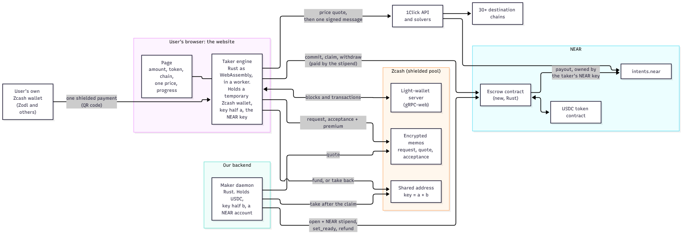
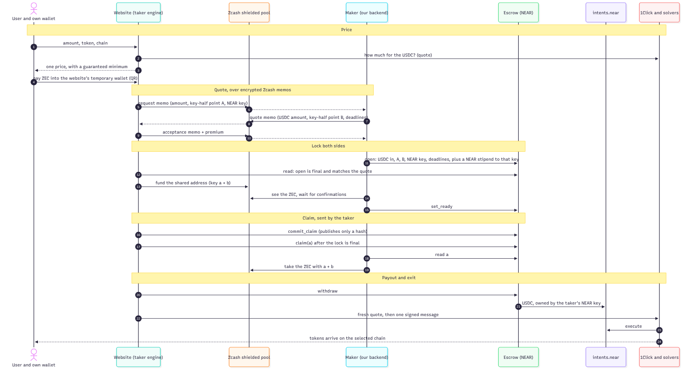
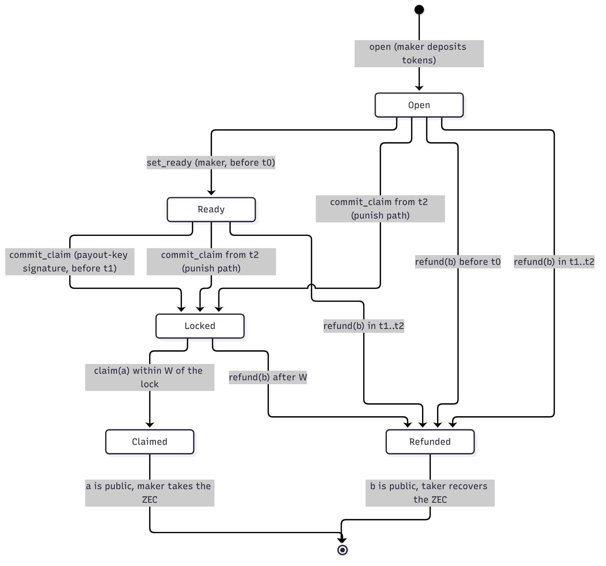

# Design: trustless shielded ZEC to NEAR, then anywhere

Status: in revision, 2026-11-13. The project is Zecret. The repository is
`officialcmg/zecret`.

## The design in plain words

This section is always current. The numbered sections below give the detail.

**What the app does**

1. A user has shielded ZEC. The user wants a token on another chain.
2. The user opens the app. The user selects an amount, a token and a chain.
3. The app shows one price. The price has two parts:
   - the USDC that the maker pays for the ZEC;
   - the destination tokens that NEAR Intents pays for that USDC.
4. The user accepts. The app shows a QR code. The user pays the ZEC from the user's own
   wallet. The swap starts. The user downloads nothing.

**Who does what**

- The **maker** is our backend. The maker holds USDC on NEAR.
- The **taker** is the user. The taker software is a website. It runs in the user's
  browser. It makes a temporary Zcash wallet and holds the keys in the browser. Our
  backend never holds them.
- The **escrow** is a contract on NEAR. It holds the maker's USDC during the swap.

**How one swap runs**

0. The user's payment arrives in the temporary wallet. All the next Zcash steps come
   from that wallet.
1. The taker sends a request to the maker. The request is an encrypted memo in a
   shielded Zcash transaction.
2. The maker sends a quote. The quote is also an encrypted memo.
3. The taker sends an acceptance memo. The same transaction pays a small premium to the
   maker.
4. The maker locks USDC in the escrow. The maker also sends 0.03 NEAR to a
   new key that the taker made. This NEAR pays for the taker's transactions.
5. The taker sends the ZEC to a shared address. The key of this address has two halves.
   The taker holds one half. The maker holds the other half.
6. The maker sees the ZEC. The maker sets the escrow to Ready.
7. The taker claims the USDC with the new key. The claim publishes the taker's half of
   the key.
8. The maker now has the two halves. The maker takes the ZEC.
9. The maker sends the withdraw call. The escrow puts the USDC into NEAR Intents and
   moves it to the taker's new key there.
10. The app signs one message with that key. NEAR Intents sends the destination tokens
    to the user's address on the selected chain.

**If something goes wrong**

- If the maker stops, the maker's refund publishes the maker's half of the key. The
  taker then takes the ZEC back.
- If the exit through NEAR Intents fails, the USDC stays under the taker's key. The app
  tries again.
- If the user closes the page, the keys stay in the browser's storage. The user opens
  the page again and the swap continues. The app also gives a recovery file.
- ZEC that is left in the temporary wallet goes back to a Zcash address that the user
  gives.

**Decided**

| Date | Decision |
|---|---|
| 2026-11-13 | The maker runs in our backend. The submitted app is for takers. |
| 2026-11-13 | Messages between taker and maker are encrypted Zcash memos, as in Cloakroom. |
| 2026-11-13 | The premium stays. It is paid with the acceptance memo. |
| 2026-11-13 | The maker always pays USDC on NEAR. The token and chain that the user selects are not in the quote or the escrow. The app does the exit through NEAR Intents as a second step. |
| 2026-11-13 | The taker software runs in the browser as WebAssembly. The user visits a website and downloads nothing. One shielded send costs about 25 s of computing in the browser. Tested in `experiments/wasm-prover`. |
| 2026-11-13 | The website makes a temporary Zcash wallet. The user pays into it once, by QR code. It reads Zcash through a gRPC-web light-wallet server. Tested in `experiments/grpc-web`. |
| 2026-11-13 | The maker limits open requests: at most 32 requests wait for a quote, a request expires after 1 hour, and the maker builds at most 1 quote in each cycle. The maker does its refund duties before it handles new requests. Reason: many unpaid requests made the maker slow enough to miss a refund deadline. |
| 2026-11-13 | The maker can check that the premium is worth more than the stipend and its other costs. On mainnet this check is required. |
| 2026-11-13 | The escrow pays a taker in two steps. First it puts the USDC into its own account inside NEAR Intents. Then it moves the USDC to the taker with one transfer inside Intents. A payout can happen only once. Reason: with the real USDC contract, a pause or a blocklist at the wrong moment made the old one-step payout report a failure after the taker was paid, and a second withdraw paid again. The withdraw call now needs 200 Tgas. See `docs/security/nv02-usdc.md` and `fixes-2.md`. |
| 2026-11-13 | The maker sends the withdraw call after the claim is final. The call needs about 0.1 NEAR for gas in advance, and the taker's stipend cannot pay that. Any account can send it; the money can only go to the taker. |
| 2026-11-13 | Before the taker sends ZEC, it checks the escrow: the code hash is the expected one, the account has no access keys, and its Intents account is the expected one. |
| 2026-11-13 | The maker compares every field of a swap in the escrow with its own record before it sends the stipend or sets Ready. |
| 2026-11-13 | The quote memo carries the USDC amount, the stipend, the escrow and maker accounts and a signature. The token is not in the memo. The taker reads the token from its configuration and checks it in the escrow. |
| 2026-11-13 | The exit needs no API key. Before the app signs, it checks 1Click's signature on the quote and that the payload moves the approved amount of the approved token to the quoted deposit address, and nothing else. See `docs/INTENTS.md`. |
| 2026-11-13 | The stipend is 0.03 NEAR, not 0.01. NEAR accepts a transaction only if the sender holds about 10 times the gas cost. With 0.01 NEAR the taker's commit is rejected. The real cost of commit and claim is about 0.002 NEAR. Measured in `contracts/near-escrow` sandbox tests. |
| 2026-11-13 | The maker pays in advance for the storage of its swaps in the escrow. The escrow has `add_storage_funds`. Without this, any account could fill the escrow's storage. |
| 2026-11-13 | The maker sends a NEAR stipend to the taker's new key. The taker submits the commit and the claim. No relayer is necessary. Tested in `experiments/intents-sandbox`. |
| 2026-11-13 | On local and testnet networks, NEAR Intents has no 1Click. There the app signs one transfer from NEAR Intents to a NEAR account that the user gives. The maker sends that transfer and pays its gas. The stipend cannot pay for it: the transfer needs 40 Tgas, and the rest of the stipend pays for about 25 Tgas. Measured in `crates/zecret-wasm/tests/sandbox.rs`. The maker sends only transfers that its own takers signed. |
| 2026-11-13 | The recovery file holds the temporary wallet key, key half `a`, the swap seeds, the NEAR key and the swap settings. It is not encrypted. A file saved before the payment is enough: after a restore, the app reads from the chains which messages and payments already went out, and it sends nothing twice. |
| 2026-11-13 | The project name is Zecret. The repository is `officialcmg/zecret`. |
| 2026-11-13 | Correction to the withdraw entry above. The withdraw call needs 200 Tgas. NEAR accepts it only if the sender holds about 0.2 NEAR, not 0.1 NEAR. The stipend cannot pay that. |

**Open**

| Question | Status |
|---|---|
| The taker trusts one NEAR RPC endpoint. | Open. A false endpoint that works with the maker can take the taker's ZEC. See section 10. |
| Who sends withdraw if the maker stops after the claim? | Open. The taker cannot pay for it. Any account can send it. The USDC can only go to the taker. |
| The residual USDC case. | Open. The tokens can stay in NEAR Intents, credited to nobody. Nobody is paid twice. See section 10. |
| The taker-side bugs of security review 2 (F2-01, F2-02, F2-03). | Open. See `docs/security/review-2.md`. |

## 1. What we are building

A website that swaps shielded ZEC for a token on another chain, with no custodian.

| Part | What it does | New or baseline |
|---|---|---|
| (a) Trustless swap | Shielded ZEC for USDC on NEAR. The ZEC never leaves the shielded pool. | The protocol is baseline (Cloakroom paper and repo). The NEAR escrow, the NEAR client code and the browser build are new. |
| (b) Any chain out | The USDC lands inside NEAR Intents and exits to 30+ chains. | New. |
| (c) No gas trail | The taker's NEAR key is paid for by the maker, who already knows about the swap. | New. This closes the relayer gap the paper lists as its top open item. |

**Baseline** means work that existed before this hackathon: the protocol, its proofs, the
TLA+ model, the Zcash wallet code and the maker and taker state machines in
`officialcmg/cloakroom`. The new repository imports that code as commit `2f8e2f7`.
GitHub has it as the branch `pre-hackathon-baseline`; the tag `pre-hackathon` exists in
the build clone. Everything after that commit is hackathon work, and the README says so.

## 2. System map

| Component | Runs where | Job |
|---|---|---|
| Page | User's browser | Amount, token and chain; one price; progress; recovery file. |
| Taker engine | User's browser, in a Web Worker | Cloakroom's taker logic and Zcash wallet, compiled to WebAssembly. Holds the temporary wallet, key half `a` and the NEAR key. |
| Maker daemon | Our backend | Holds USDC, key half `b` and a NEAR account. Answers requests, opens escrows, sends the stipend, takes the ZEC, refunds. |
| Light-wallet server | Zcash | Gives the browser blocks and accepts transactions over gRPC-web. |
| Escrow contract | NEAR | Holds the maker's USDC. Two exits, each publishing one key half. |
| `intents.near` | NEAR | Receives the payout, owned by the taker's NEAR key. |
| 1Click API and solvers | Off-chain | Quote the exit and deliver on the destination chain. |

The maker and the taker engine are the same Rust code base. The maker builds as a normal
program; the taker builds as WebAssembly.

## 3. One swap, start to finish

What is the same as Cloakroom: the three memos (request, quote, acceptance with
premium), the shared address, and the escrow rules.

What is new:

- **Step 4, one payment.** The user's wallet never needs to know about the protocol.
- **Step 11, the stipend.** After `open`, the maker sends 0.03 NEAR to the account
  named by the taker's fresh ed25519 key. That creates the account.
- **Steps 16 and 17, the taker sends her own commit and claim.** No relayer. The maker
  never sees `a` before it is on-chain, so the maker cannot take the ZEC and withhold
  the claim.
- **Steps 20 to 24, payout and exit.** The USDC goes into `intents.near` under the same
  key, and one signed message sends it on.

**Duration:** the first estimate was about 10 minutes, most of it waiting for Zcash
blocks. One swap on Zcash testnet and NEAR testnet (2026-11-13, native maker and taker,
cover delays off) took 222 s from the taker's start to `Completed`, and 322 s to the end
of the exit (`docs/TESTNET.md`). Zcash testnet blocks came faster than the 75 s that the
configs assume. A swap on mainnet was not measured.

## 4. Escrow contract

The state machine is the paper's Table 1, unchanged.

| Call | Who sends it | NEAR-specific design |
|---|---|---|
| `open` | Maker | Sent as `ft_transfer_call` on the USDC contract with the swap terms in `msg`. The escrow's `ft_on_transfer` validates and stores the swap. The escrow sees exactly the amount that arrived. |
| `set_ready` | Maker | Maker only, before `t0`. |
| `commit_claim` | Anyone (the taker in practice) | Verifies an ed25519 signature by the taker's NEAR key over (escrow account, swap id, commitment). Stores only the hash. |
| `claim(a)` | Anyone | Checks the hash, checks `a·G = A` on Pallas, stores `a` in contract state and credits the taker. No token movement. |
| `refund(b)` | Anyone | Checks `b·G = B`, stores `b`, credits the maker. No token movement. |
| `withdraw` | Anyone | Pays a credit. The maker's goes out by `ft_transfer`. The taker's goes out in two steps: `ft_transfer_call` puts the tokens into the escrow's own account inside `intents.near`, then `mt_transfer` moves them to the taker's account there. The credit is restored only if `mt_transfer` fails. Needs 200 Tgas. |
| `sweep` | Anyone | Brings tokens that are stranded in the escrow's own Intents account back to the escrow. It changes no credit and can pay only the escrow. |

Design choices:

- **One taker key.** It is ed25519. Its NEAR account ID and its Intents account ID are
  both the hex of the public key. It signs the commit, sends the claim and signs the
  exit.
- **The relayer fee is gone.** The paper's `relayerFee` existed to pay a relayer. With
  the stipend there is no relayer, so the field is dropped.
- **Revealed halves are stored in contract state.** Clients read `a` or `b` with a view
  call at a final block.
- **Swap id** is `sha256(maker account, salt)`.
- **`claim` and `refund` make no cross-contract calls**, so a token problem can never
  make a call that reveals a key half fail.

## 5. The gas trail

On Base, the taker's payout address had no ETH, so some key had to be funded, and that
funding could link the taker to the swap.

Here the maker funds the taker's key. The maker already knows the swap exists, so
nothing new is revealed, and the taker's own money never touches NEAR gas.

Limits that stay:

- The stipend costs the maker 0.03 NEAR for each opened swap. The premium covers it.
  Commit and claim use about 0.002 NEAR of it; the rest stays in the taker's account.
- The light-wallet server, the NEAR RPC and the 1Click API each see the user's IP
  address unless the user uses Tor or a VPN.
- The paper's timing analysis still applies: a swap that is not delayed hides among few
  others. Cover delays exist in the code and in one local scenario (`s12`), but are off
  in the testnet configs and the website.
- The exit destination is public unless the user selects Confidential Intents.

## 6. The browser taker

| Fact | Value | Source |
|---|---|---|
| Proving key build, once per page load | about 19 s | `experiments/wasm-prover` |
| One shielded send | about 25 s of computing | `experiments/wasm-prover` |
| Sends per swap | 3 (request, acceptance, funding); 1 more for a refund | protocol |
| Reading blocks from a browser | works over gRPC-web | `experiments/grpc-web` |

Rules for the engine:

- It runs in a Web Worker so the page stays responsive. The key build starts at page load.
- It stores its state, including `a`, in the browser's storage after every step. The
  page offers a recovery file as soon as the wallet exists.
- The taker must stay online from the commit until the claim is final. On NEAR that is
  about a minute, against hours on Base.
- Cloakroom's client shells out to `cast`, uses blocking HTTP and sleeps in loops. The
  shared code is changed to plain request functions behind a small interface, with one
  implementation for the browser (`fetch`) and one for the maker.

## 7. Timing

The paper's reorganization budget is `B_R = (R+1)·D + R·F`. On Base, with `F` near 20
minutes, it came to 70 minutes and a 1.75-hour reveal window.

NEAR testnet was measured twice, with two different clients. Both are small samples
from one machine and one RPC provider (`rpc.testnet.fastnear.com`). In both, the clock
starts before the client signs, so the figures include client and RPC latency.

| From submit to | 2026-11-12: 20 transfers (`experiments/near-timing`) | 2026-11-13: 14 swap transactions (`zecret-deploy e2e`, `docs/DEPLOY.md`) |
|---|---|---|
| Included in a block | median 7.6 s (7.2 to 7.9 s) | median 1.6 s (0.9 to 2.0 s) |
| Its block final | median 8.7 s (8.4 to 9.2 s) | median 2.9 s (2.4 to 3.3 s) |
| All receipts final | median 10.0 s (9.6 to 10.4 s) | median 4.5 s (3.9 to 6.9 s) |

The second client polls the transaction status every 0.2 s with `wait_until: NONE`. The
code of the first client is not in this repository, and its write-up does not say how it
waited. The cause of the difference was not investigated. In the swap on public test
networks, the taker's `commit_claim` was in a block at 05:42:07.5 UTC and its claim was
final at 05:42:18.1 UTC, 10.6 s later (`docs/TESTNET.md`).

With generous bounds of `D = 30 s`, `F = 10 s` and `R = 2`, which cover both measurements,
the budget is `B_R = 110 s`.
The token-side windows shrink from hours to a few minutes. Mainnet needs its own
measurement before real parameters are fixed.

## 8. Networks

| Mode | Zcash | NEAR | Exit through Intents | Use |
|---|---|---|---|---|
| Local | Zebra regtest in Docker, through a small CORS proxy | Sandbox 2.14.1 with the live `intents.near` code | Signed message executed in the sandbox | Development and automatic tests |
| Testnet | Zcash testnet over ChainSafe's gRPC-web | NEAR testnet, with a test USDC token and a copy of the `intents.near` code as a stand-in verifier (`deploy/deployment.testnet.json`) | The payout into the stand-in verifier and a signed withdrawal run for real. The cross-chain delivery shows a live quote only, because Intents has no testnet | Tests on public networks with no real money. One full swap ran here with the native maker and taker on 2026-11-13 (`docs/TESTNET.md`). The website is not hosted. |
| Mainnet | Zcash mainnet | NEAR mainnet | Real | Full demo with small amounts. Needs the owner's funds and approval. Not deployed. |

## 9. What has been tested

| Question | Result | Where |
|---|---|---|
| Does the Pallas key-half check fit in NEAR gas? | Yes: 16.2 Tgas of 300. | `experiments/gas-spike` |
| Does the ed25519 signature check work natively? | Yes: 1.8 Tgas. | `experiments/gas-spike` |
| Can a key with no NEAR account own funds in Intents and move them with a signature? | Yes, against the code live on `intents.near`. | `experiments/intents-sandbox` |
| Does a small stipend make a fresh key usable? | Yes. 0.01 NEAR creates the account, but 0.03 NEAR is needed to send the commit and the claim. | `contracts/near-escrow` sandbox tests |
| Does an exit quote work without an API key? | Yes: 5 USDC to Base quoted at 4.997 USDC, 12 s. | 1Click dry run |
| How fast is NEAR? | Two small samples on testnet: about 8 s to inclusion and 10 s to fully final (first client); 1.6 s and 4.5 s (second client). See section 7. | `experiments/near-timing`, `docs/DEPLOY.md` |
| Does the prover run in a browser? | Yes: about 25 s for one proof in Chromium. | `experiments/wasm-prover` |
| Can a browser read Zcash blocks? | Yes, over gRPC-web. | `experiments/grpc-web` |
| Does a local Zcash node run in the build environment? | Yes, Zebra regtest in Docker. | manual |
| Does the Zcash wallet run in a browser worker, end to end? | Yes, on Zebra regtest: it receives a shielded payment, reads its memo, and builds, proves and sends a shielded transaction. | `experiments/browser-wallet`, `spike/browser-wallet/` |
| Do the native maker and taker complete a swap as two programs? | Yes: 19 scenarios on Zebra regtest and a NEAR sandbox, with the happy path, refund, punish and malicious-party cases. | `harness/RESULTS.md` |
| Does a full swap run on public test networks? | Yes, once: 0.1 testnet ZEC for 3 test USDC on Zcash testnet and NEAR testnet, native maker and taker, happy path only. | `docs/TESTNET.md` |
| Can the real USDC contract make the escrow pay twice? | Yes, with the old one-step payout: a USDC pause or blocklist between delivery and USDC's resolve step made a second withdraw pay again. Fixed with the two-step payout; 8 sandbox tests with the USDC code from mainnet pass on the new escrow and fail on the old one. | `docs/security/nv02-usdc.md`, `docs/security/fixes-2.md` |
| Does the taker run in the browser as the real engine, wired into the website? | In progress (package E). Not verified. | `STATUS.md` |

Tests must use NEAR sandbox 2.14.1, the version on mainnet. Version 2.9.0 rejects the
live Intents code.

## 10. Risks and open questions

| Risk | Why it matters | Plan |
|---|---|---|
| The taker engine in the browser is not finished | The browser spike ran scanning, memo decryption, transaction building and sending in WebAssembly on Zebra regtest. The full taker engine in the browser, wired into the website, is still being built (package E) and is not verified. | Finish package E and its browser scenarios. The website runs against a simulated engine until then. |
| Sending a transaction over gRPC-web | The native client sent all its Zcash transactions through ChainSafe's gRPC-web server in the testnet swap. From a browser, sending was tested only on regtest, through Zebra's JSON-RPC. | Test a send from the browser on testnet. |
| ChainSafe's public endpoints | We depend on a third party's free server. | Run our own gRPC-web proxy in front of a light-wallet server if needed. |
| Intents has no testnet | The exit only executes on mainnet. | Sandbox for tests, live quote on testnet, real exit on mainnet with the owner's approval. |
| 1Click exit with real funds | Quote, generate and submit all answer without an API key (tested live with an unfunded key). Execution with funds is not verified. | First real run on mainnet with a tiny amount. See `docs/INTENTS.md`. |
| Price movement before the exit | Measured over 15 minutes: USDC to USDC moved 0.004 %; USDC to SOL or ETH fell at most 0.32 % within 10 minutes. | Show a guaranteed minimum with 1 % slippage and fetch a fresh quote at exit time. |
| Keys in browser storage | A cleared browser loses the swap's keys. | Recovery file, shown before any money moves. |
| The build environment is temporary | Docker, the sandbox binary and helper tools must be set up again on a new machine. | Done: `scripts/setup-env.sh`. Commit and push often. |
| The taker trusts one NEAR RPC endpoint | The taker reads every NEAR fact it acts on from one endpoint, without proofs. An endpoint that works with the maker can show an escrow that does not exist, and the maker then takes the taker's ZEC. An endpoint alone can only delay a swap. | Not built. Options: let the user choose the endpoint; compare two or more endpoints; light-client proofs. See `docs/security/fixes-2-core.md` section 4. |
| The taker cannot pay for `withdraw` | `withdraw` needs 200 Tgas, so the sender must hold about 0.2 NEAR. The stipend leaves about 0.028 NEAR. If the maker stops after the claim, the USDC stays in the escrow, credited to the taker, until some account sends `withdraw`. Any account can send it, and the tokens can only go to the taker. | Open: a larger stipend, or say it plainly in the app and the documents. |
| The residual USDC case | If the deposit into NEAR Intents fails and USDC's resolve step panics in the same window, the tokens stay in the Intents contract, credited to nobody. The escrow pays nobody twice, but its last USDC withdraw fails until the Intents operators return the tokens. Not tested. | Open. See `docs/security/fixes-2.md` section 5. |
| Taker-side bugs of security review 2 | F2-01 and F2-02 (medium) and F2-03 (low) are not fixed. The maker side is fixed. | Next fix round. See `docs/security/review-2.md` and `docs/security/fixes-2-core.md` section 6. |
